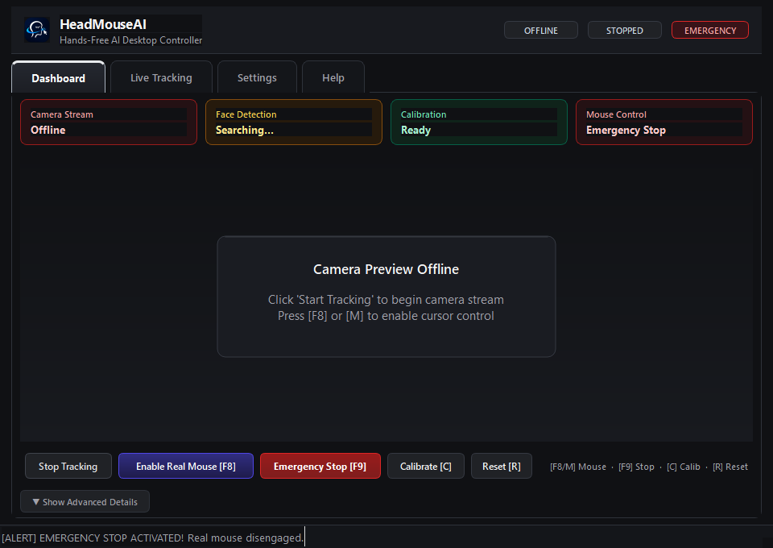
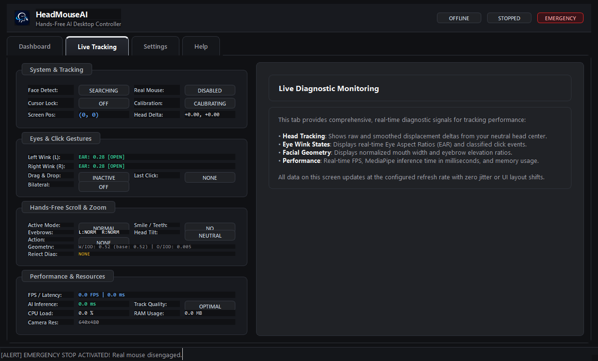
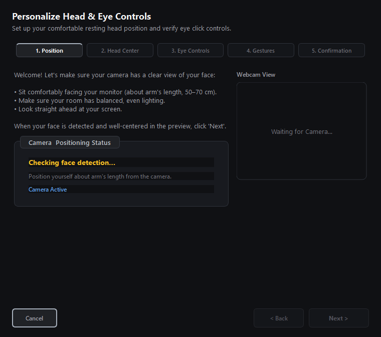
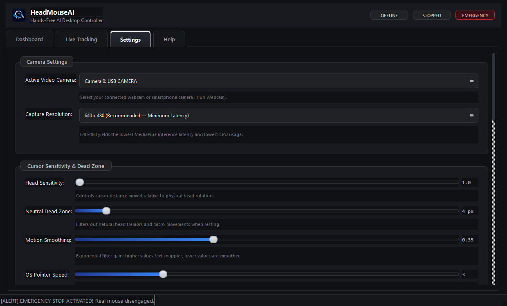

# HeadMouseAI

[](https://github.com/Harshsolanki9009/HeadMouseAI)
[-0078D6.svg)](https://www.microsoft.com/windows)
[](https://www.python.org/)
[-41CD52.svg)](https://www.qt.io/)
[](https://developers.google.com/mediapipe)
[](#design-identity)
[](LICENSE.txt)

> **Hands-Free Control. Limitless Possibilities.**  
> *A Product by ACROPOLIANS*

**HeadMouseAI** is an AI-powered, hands-free Windows desktop mouse controller designed for precision accessibility and hands-free interaction. Powered by on-device computer vision and Google MediaPipe Face Landmarker, HeadMouseAI translates subtle head movement into smooth cursor navigation, detects independent left/right eye winks for clicking, provides hold-to-drag capabilities, and enables gesture-based scrolling and zooming without physical contact.

---

## Visual Previews (Obsidian Chrome UI)

| Dashboard Screen | Live Tracking View |
| :---: | :---: |
|  |  |

| Calibration Wizard | Settings & Controls |
| :---: | :---: |
|  |  |

---

## Key Features

- **Natural Head Navigation**: Smooth nose-tip coordinate mapping with Kalman filtering and configurable resting dead zones to filter out micro-tremors.
- **Independent Eye Wink Clicks**:
  - **Left Eye Wink**: Dispatches standard left click.
  - **Right Eye Wink**: Dispatches standard right click.
  - **Simultaneous Blink Filtering**: Natural bilateral blinks are ignored to prevent accidental clicking.
- **Click Position Stabilization**: Cursors lock into place during intentional winks for high targeting precision.
- **Hands-Free Drag & Drop**: Holding your left eye closed for $>0.38\text{ s}$ engages drag mode; an eye open or subsequent wink cleanly drops the selection.
- **Hands-Free Scroll & Zoom**:
  - **Smile / Teeth Show**: Activates continuous hands-free Scroll Mode (Head UP = Scroll Up, Head DOWN = Scroll Down, Neutral = Stop).
  - **Smile + Both Eyebrows Raised**: Switches seamlessly to Zoom Mode (Head UP = Zoom In, Head DOWN = Zoom Out).
  - **Automatic Resumption**: Lowering eyebrows returns automatically to Scroll Mode.
  - **Hysteresis & Grace**: Debounced against facial micro-movements, lip perspective compression, and brief frame drops.
- **Guided 4-Step Calibration**: Interactive calibration wizard with live camera preview calibrating resting center and eye baselines in under 20 seconds.
- **Safety Interlocks by Default**:
  - **Real Mouse strictly DISABLED by default** upon launching.
  - **`F8` / `M` Hotkey Toggle**: Toggle OS cursor control on and off with debounced state machine.
  - **`F9` Emergency Stop**: Global fail-safe hotkey instantly disengaging mouse control and releasing held buttons.
  - **Face-Loss Auto-Freeze**: Cursor navigation instantly halts whenever the user turns away from the webcam.
- **Obsidian Chrome Visual Identity**: Dark desktop aesthetics (#101114 / #181A1F), metallic silver typography (#A7B0BC / #F5F5F5), accessible contrast, and tabular telemetry displays.

---

## Installation & Getting Started

### 1. Windows Installer (`HeadMouseAI_Setup.exe`) — Recommended
1. Download **`HeadMouseAI_Setup.exe`** from `dist/installer/`.
2. Run the installer (built with Inno Setup 6).
3. Choose your destination directory (defaults to `C:\Program Files\HeadMouseAI` or per-user local programs).
4. Optionally check **Create Desktop Shortcut**.
5. Click **Install**. The installer configures Start Menu shortcuts and registers full uninstallation support in Windows Settings.

### 2. Standalone Executable (`dist/HeadMouseAI/`)
1. Open the standalone folder at `dist/HeadMouseAI/`.
2. Run **`HeadMouseAI.exe`**.
3. All dependencies, MediaPipe models, and PySide6 runtimes are self-contained.

### 3. Running from Source (Developers)
```powershell
# Clone the repository
git clone https://github.com/Harshsolanki9009/HeadMouseAI.git
cd HeadMouseAI

# Set up virtual environment
python -m venv .venv
.venv\Scripts\activate

# Install required dependencies
pip install -r requirements.txt

# Run the application
python app.py
```

---

## Quick Start & Controls Reference

1. **Camera Position**: Mount your webcam at eye level, roughly 50–70 cm away, ensuring your face is evenly illuminated.
2. **Start Tracking**: Click **Start Tracking** on the Dashboard.
3. **Calibrate**: Press **`[C]`** or click **Calibrate** to run the 4-step wizard.
4. **Arm Real Mouse Control**: Press **`[F8]`** or **`[M]`** when you are ready to control Windows.
5. **Emergency Stop**: Press **`[F9]`** at any time to instantly disconnect and halt mouse control.

### Keyboard Shortcuts Reference

| Shortcut | Scope | Action | Description |
| :---: | :---: | :--- | :--- |
| **`F8`** or **`M`** | Global | **Toggle Real Mouse** | Arms or disarms OS mouse cursor injection (Disabled by default). |
| **`F9`** | Global | **Emergency Stop** | Instantly kills real mouse control and releases any active drag states. |
| **`C`** | Focused | **Calibrate** | Opens the guided calibration wizard. |
| **`R`** | Focused | **Reset Trackers** | Centers cursor and clears Kalman filter history. |
| **`Esc`** | Focused | **Exit** | Safely terminates video capture threads and exits the application. |

---

## System Requirements

| Requirement | Minimum Specification | Recommended Specification |
| :--- | :--- | :--- |
| **Operating System** | Windows 10 (64-bit, version 19041+) | Windows 11 (64-bit, latest release) |
| **Processor** | Dual-core Intel or AMD ($2.0\text{ GHz}$) with AVX support | Quad-core Intel Core i5 / AMD Ryzen 5 or higher |
| **Memory (RAM)** | $4\text{ GB}$ RAM | $8\text{ GB}$ RAM |
| **Storage** | $300\text{ MB}$ free disk space | $500\text{ MB}$ SSD storage |
| **Camera** | Standard USB webcam ($640\times 480$ @ $30\text{ FPS}$) | 720p / 1080p USB webcam or Iriun smartphone webcam |
| **Display** | $1280\times 720$ resolution | $1920\times 1080$ Full HD resolution |

---

## Known Limitations (v1.0.0-beta.1)

1. **Lighting & Backlighting**: Computer vision tracking requires adequate, even facial lighting. Extreme backlighting (e.g. sitting in front of a bright window) can degrade eye landmark detection.
2. **Webcam Alignment**: The tracking model operates optimally when the camera is placed directly in front of the user at eye level (within $\pm 25^\circ$ angle).
3. **Thick Eyeglass Reflections**: Heavy glare or thick-framed lenses may occasionally interfere with subtle eye wink closure detection; recalibrating via the 4-step wizard with your glasses on resolves most issues.
4. **DirectShow Camera Indices**: If multiple cameras or virtual drivers (such as OBS Virtual Camera or disconnected Iriun instances) are installed on your machine, ensure the active camera index is selected in Settings.
5. **CPU Architecture**: HeadMouseAI uses MediaPipe Face Landmarker; legacy CPUs without AVX/SSE instruction sets are not supported.

---

## Architecture & Verification Status

```
HeadMouseAI/
├── app.py                      # Application entry point with native taskbar integration
├── config.toml                 # User-editable persistent configuration
├── HeadMouseAI.spec            # Size-optimized PyInstaller build specification
├── core/
│   ├── blink_detector.py       # Independent EAR calculation & blink/drag classifier
│   ├── camera.py               # Robust DirectShow video capture & fallback handling
│   ├── mouse_controller.py     # OS mouse injection via PyAutoGUI with safety interlocks
│   ├── nose_tracker.py         # Nose tip landmark extraction & Kalman stabilization
│   └── gesture_zoom.py         # Gesture zoom & scroll controllers
├── gui/
│   ├── main_window.py          # Primary PySide6 dashboard & top tab navigation
│   ├── styles.py               # Obsidian Chrome dark metallic theme & tokens
│   ├── worker.py               # Background VisionWorker QThread pipeline
│   ├── dialogs/                # Calibration wizard & Welcome onboarding dialogs
│   └── widgets/                # Telemetry cards, Control bar, Video widgets
├── installer/
│   └── HeadMouseAI_Setup.iss   # Inno Setup 6 compilation script
└── tests/                      # Automated test suite (160 passed unit tests)
```

- **Unit & Integration Tests**: 160 passing tests (`pytest tests`)
- **Compilation Check**: `compileall` Exit Code 0 across all modules
- **Real-World Hardware**: Tested on DirectShow USB camera and Iriun Webcam drivers
- **Installation Test**: Clean silent install and clean uninstall verified on Windows 10/11 x64

---

## License

HeadMouseAI is distributed under the [Apache 2.0 License](LICENSE.txt).

**ACROPOLIANS** — *Hands-Free Control. Limitless Possibilities.*
