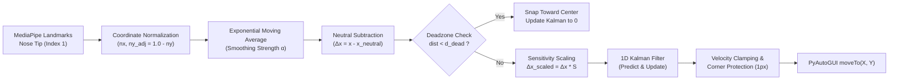
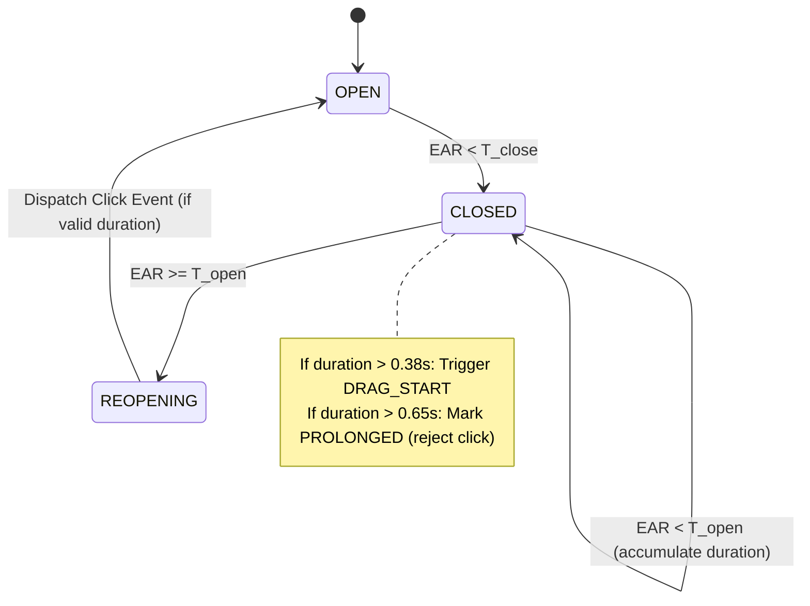
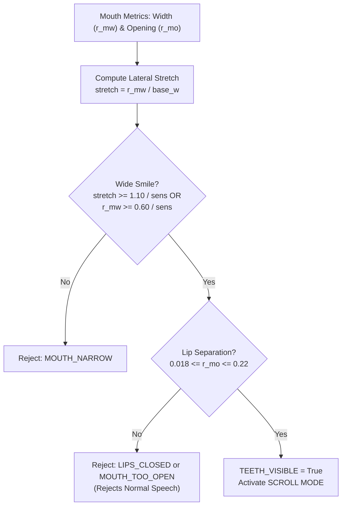
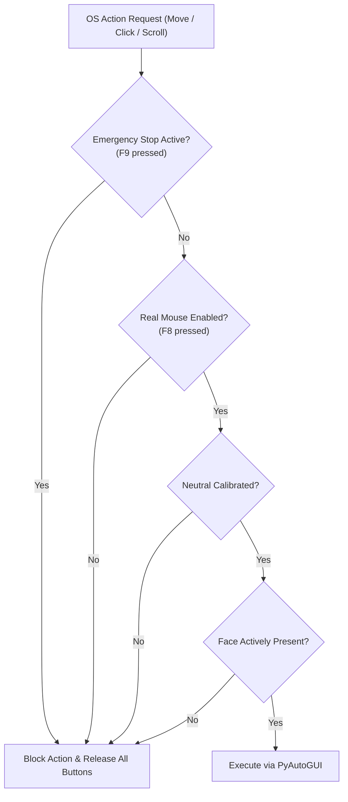

# HeadMouseAI — Mathematical & Algorithmic Documentation

> **Document Type:** Algorithm & Mathematical Specification  
> **Target Project:** HeadMouseAI (Windows Desktop Hands-Free Controller)  
> **Status:** Production / Release Candidate (`v1.0.0-beta.2`)  
> **Audit Date:** November 2026  
> **Verification Status:** Verified against Actual Source Implementation  

---

## 1. Nose-Based Cursor Navigation Pipeline

The nose tracking subsystem maps subtle head rotations into smooth, responsive, and tremor-free desktop cursor navigation.



### 1.1. Coordinate Normalization & Axis Inversion
The 3D face mesh provides normalized coordinates $(x, y, z)$ where $x, y \in [0.0, 1.0]$. In raw image coordinates, the vertical axis origin $(0, 0)$ is at the top-left corner, meaning increasing $y$ moves downward.

To align with intuitive human motion (moving head up increases vertical position):
$$nx = x_{\text{raw}}$$
$$ny_{\text{adj}} = 1.0 - y_{\text{raw}}$$

### 1.2. Exponential Moving Average (EMA) Smoothing
To eliminate high-frequency camera sensor noise before displacement calculation, an Exponential Moving Average is applied:
$$\tilde{x}_t = \alpha \cdot nx_t + (1 - \alpha) \cdot \tilde{x}_{t-1}$$
$$\tilde{y}_t = \alpha \cdot ny_{\text{adj}, t} + (1 - \alpha) \cdot \tilde{y}_{t-1}$$
where $\alpha \in [0.01, 1.0]$ is the smoothing factor (default: $\alpha = 0.35$).

### 1.3. Relative Displacement from Calibrated Neutral Baseline
During calibration, the system records the user's natural resting head pose $(\bar{x}_{\text{neutral}}, \bar{y}_{\text{neutral}})$ over $N$ frames (default $N = 30$):
$$\bar{x}_{\text{neutral}} = \frac{1}{N}\sum_{i=1}^N nx_i, \quad \bar{y}_{\text{neutral}} = \frac{1}{N}\sum_{i=1}^N ny_{\text{adj}, i}$$

The instantaneous relative displacement is:
$$\Delta x = \tilde{x}_t - \bar{x}_{\text{neutral}}$$
$$\Delta y = \tilde{y}_t - \bar{y}_{\text{neutral}}$$

### 1.4. Radial Deadzone Filtering
To prevent unintended micro-tremors and natural breathing oscillations from moving the cursor while reading or resting, a radial Euclidean deadzone threshold is enforced:
$$r = \sqrt{(\Delta x \cdot W)^2 + (\Delta y \cdot H)^2}$$
where $W$ and $H$ are the preview window width and height in pixels.

* **If $r < d_{\text{dead}}$ (default $d_{\text{dead}} = 4.0\text{ px}$):**
  Displacement is suppressed. The Kalman filters are stepped with measurement $0.0$ and the target smoothly returns to resting center.
* **If $r \ge d_{\text{dead}}$:**
  Displacement is scaled by user sensitivity $S$:
  $$\Delta x_{\text{scaled}} = \Delta x \cdot W \cdot S$$
  $$\Delta y_{\text{scaled}} = \Delta y \cdot H \cdot S$$

### 1.5. 1D Scalar Kalman Filter Smoothing
Each axis ($X$ and $Y$) is smoothed independently using a discrete 1D Kalman filter to eliminate trajectory lag while preserving crisp stops:

1. **Prediction Step:**
   $$\hat{x}_{t|t-1} = \hat{x}_{t-1|t-1}$$
   $$P_{t|t-1} = P_{t-1|t-1} + Q$$
2. **Measurement Update Step:**
   $$K_t = \frac{P_{t|t-1}}{P_{t|t-1} + R}$$
   $$\hat{x}_{t|t} = \hat{x}_{t|t-1} + K_t \cdot (z_t - \hat{x}_{t|t-1})$$
   $$P_{t|t} = (1 - K_t) \cdot P_{t|t-1}$$

* **Process Noise ($Q$):** $0.05$ (represents head movement model uncertainty).
* **Measurement Noise ($R$):** $0.20$ (models sensor and camera landmark variance).

### 1.6. Screen Pixel Mapping & Corner Clamping
The normalized filtered target $(\hat{x}_{\text{norm}}, \hat{y}_{\text{norm}}) \in [0.0, 1.0]$ is mapped to Windows OS screen resolution $(W_{\text{screen}}, H_{\text{screen}})$:
$$X_{\text{screen}} = \text{round}(\hat{x}_{\text{norm}} \cdot (W_{\text{screen}} - 1))$$
$$Y_{\text{screen}} = \text{round}(\hat{y}_{\text{norm}} \cdot (H_{\text{screen}} - 1))$$

To prevent accidental tripping of PyAutoGUI's hardware failsafe (which aborts if the cursor hits coordinate $(0, 0)$), coordinates are clamped 1 pixel away from screen boundaries:
$$X_{\text{safe}} = \max(1, \min(W_{\text{screen}} - 2, X_{\text{screen}}))$$
$$Y_{\text{safe}} = \max(1, \min(H_{\text{screen}} - 2, Y_{\text{screen}}))$$

### 1.7. Maximum Velocity Clamping
To prevent sudden cursor teleportation caused by dramatic head turns:
$$\Delta_{\text{step}} = \sqrt{(X_{\text{target}} - X_{\text{current}})^2 + (Y_{\text{target}} - Y_{\text{current}})^2}$$
$$\text{If } \Delta_{\text{step}} > V_{\max} \cdot \Delta t: \quad X_{\text{new}} = X_{\text{current}} + (X_{\text{target}} - X_{\text{current}}) \cdot \frac{V_{\max} \cdot \Delta t}{\Delta_{\text{step}}}$$

---

## 2. Independent Eye Wink & Blink Detection

Left and right eye closures are tracked independently without pupil or iris tracking.

### 2.1. Eye Aspect Ratio (EAR) Mathematical Formulation
The Eye Aspect Ratio ($\text{EAR}$) measures the ratio between the vertical eyelid opening distance and the horizontal eye corner distance using 6 canonical MediaPipe Face Mesh landmarks:

$$\text{EAR} = \frac{\|p_{\text{top1}} - p_{\text{bottom1}}\|_2 + \|p_{\text{top2}} - p_{\text{bottom2}}\|_2}{2 \cdot \|p_{\text{corner1}} - p_{\text{corner2}}\|_2}$$

```
           p_top1 (160)     p_top2 (158)
             •                 •
   p_c1 (33) •─────────────────• p_c2 (133)
             •                 •
          p_bottom1 (144)   p_bottom2 (153)
```

#### Exact Canonical MediaPipe Landmark Indices:
* **Left Eye:**
  * Corner 1: `33` (Lateral), Corner 2: `133` (Medial)
  * Top 1: `160`, Bottom 1: `144`
  * Top 2: `158`, Bottom 2: `153`
* **Right Eye:**
  * Corner 1: `263` (Lateral), Corner 2: `362` (Medial)
  * Top 1: `385`, Bottom 1: `380`
  * Top 2: `387`, Bottom 2: `373`

Typical values: Open eye $\text{EAR} \approx 0.25 - 0.35$; Closed eye $\text{EAR} \approx 0.05 - 0.14$.

---

### 2.2. Schmitt Trigger Hysteresis State Machine

To prevent rapid flickering and false triggers when an eyelid is near the decision threshold, each eye is managed by a **true Schmitt trigger finite state machine** with separate closing and opening thresholds.



#### Threshold Formulation:
Given calibrated baseline open-eye ratio $B_{\text{open}}$ (typically $\approx 0.28$) and user sensitivity factor $S \in [0.30, 0.98]$:

1. **Closing Factor ($f_{\text{close}}$):**
   $$f_{\text{close}} = \text{clip}(0.54 + 0.30 \cdot S, 0.60, 0.82)$$
2. **Closing Threshold ($T_{\text{close}}$):**
   $$T_{\text{close}} = \text{clip}(B_{\text{open}} \cdot f_{\text{close}}, 0.11, 0.26)$$
3. **Opening Threshold ($T_{\text{open}}$):**
   $$f_{\text{open}} = \min(0.92, f_{\text{close}} + \text{ratio}_{\text{hysteresis}})$$
   $$T_{\text{open}} = \text{clip}(B_{\text{open}} \cdot f_{\text{open}}, T_{\text{close}} + 0.02, 0.31)$$

*In the dead-band region $[T_{\text{close}}, T_{\text{open}})$, the current state is latched and cannot flip.*

---

### 2.3. Bilateral Simultaneous Blink Suppression
Natural simultaneous bilateral blinks must not trigger accidental left or right mouse clicks.

1. When eye $A$ transitions to `CLOSED` at time $t_A$, if the contralateral eye $B$ also closes within a temporal window $|\Delta t| < 80\text{ ms}$:
   $$\text{State}_{\text{both}} \to \text{SIMULTANEOUS\_SUPPRESSED}$$
2. Both eyes remain suppressed until **both eyes rise back above $T_{\text{open}}$**.
3. Suppressed blinks dispatch `NO_ACTION` and reset cleanly without queuing delayed clicks.

---

### 2.4. Hands-Free Hold-to-Drag & Drop
* **Activation Threshold ($t_{\text{drag}} = 0.38\text{ s}$):**
  If the left eye remains continuously closed beyond $380\text{ ms}$:
  1. The eye state transitions to `DRAGGING`.
  2. The detector emits `DRAG_START`.
  3. `MouseController` issues `pyautogui.mouseDown(button='left')`.
* **Drag Maintenance:**
  The user reopens both eyes and moves their head. The held mouse button remains engaged (`is_mouse_down = True`).
* **Drop / Release:**
  When the user performs a subsequent short left-wink or executes emergency stop / face loss, `MouseController` dispatches `pyautogui.mouseUp(button='left')` and emits `DRAG_STOP`.

---

### 2.5. Click Position Stabilization
When a user closes one eye to click, the facial muscle contraction naturally causes slight involuntary head movement, which can drift the cursor off a button.

* **Stabilization Mechanism:**
  Upon the initial closure edge ($t_{\text{closure}}$):
  1. Instantaneous coordinates $(X_{\text{screen}}, Y_{\text{screen}})$ are locked.
  2. Cursor movement is frozen at the locked position for the duration of the wink ($\le 350\text{ ms}$).
  3. Once the eye reopens and the click is dispatched, coordinates remain locked for a post-click settling window ($80\text{ ms}$) before resuming smooth Kalman tracking.

---

## 3. Gesture-Based Scroll & Zoom Subsystem

HeadMouseAI provides unified, mutually-exclusive hands-free Scroll Mode and Zoom Mode gated by facial expressions.

### 3.1. Inter-Ocular Distance (IOD) Universal Scale Normalization
All facial metrics are normalized by the **Inter-Ocular Distance (IOD)** between outer eye corners (Index 33 and Index 263):
$$\text{IOD} = \sqrt{(p_{263}.x - p_{33}.x)^2 + (p_{263}.y - p_{33}.y)^2}$$

This ensures that head distance from the camera (moving closer or further away) does not distort gesture detection thresholds.

---

### 3.2. Facial Feature Extraction Ratios

1. **Eyebrow Elevation Ratio ($r_{\text{eb}}$):**
   $$r_{\text{eb, left}} = \frac{p_{159}.y - p_{105}.y}{\text{IOD}}, \quad r_{\text{eb, right}} = \frac{p_{386}.y - p_{334}.y}{\text{IOD}}$$
2. **Mouth Width Ratio ($r_{\text{mw}}$):**
   $$r_{\text{mw}} = \frac{\sqrt{(p_{291}.x - p_{61}.x)^2 + (p_{291}.y - p_{61}.y)^2}}{\text{IOD}}$$
3. **Mouth Vertical Opening Ratio ($r_{\text{mo}}$):**
   $$r_{\text{mo}} = \frac{\sqrt{(p_{14}.x - p_{13}.x)^2 + (p_{14}.y - p_{13}.y)^2}}{\text{IOD}}$$

---

### 3.3. Teeth-Show Smile Detection Logic



#### Speech Rejection Guarantee:
Normal talking produces vertical lip separation ($0.02 \le r_{\text{mo}} \le 0.12$), but does **not** expand lateral mouth width ($\text{stretch} < 1.06$). Therefore, natural speech never engages Scroll or Zoom mode.

---

### 3.4. Continuous Rate-Limited Scrolling
When **Teeth-Show** is active:
* **Head UP ($\Delta y \ge +d_{\text{scroll}}$):** Emits continuous `SCROLL_UP` pulses.
* **Head DOWN ($\Delta y \le -d_{\text{scroll}}$):** Emits continuous `SCROLL_DOWN` pulses.
* **Head Neutral ($|\Delta y| < d_{\text{neutral}}$):** Halts scrolling immediately.

To prevent runaway scrolling, pulses are rate-limited via cooldown timer:
$$t_{\text{cooldown}} = 0.20\text{ s} \implies \text{Rate: exactly 5 pulses per second}$$

#### Head Tilt Lip Compression Hysteresis:
Tilting the head up compresses 2D vertical lip height due to perspective foreshortening. The algorithm applies a dynamic $+15\%$ tolerance margin and an $80\text{ ms}$ deactivation grace period to ensure continuous scrolling remains active during vertical head tilt.

---

### 3.5. Zoom Mode Dynamic Switching
* **Engaging Zoom Mode:** Raising both eyebrows ($r_{\text{eb}} \ge B_{\text{eb}} \cdot 1.14$) while teeth are visible switches instantly from Scroll Mode to **Zoom Mode**:
  * Head UP $\implies$ `ZOOM_IN` (`pyautogui.hotkey('ctrl', '+')`).
  * Head DOWN $\implies$ `ZOOM_OUT` (`pyautogui.hotkey('ctrl', '-')`).
* **Lowering Eyebrows:** Drops below hysteresis ($B_{\text{eb}} \cdot 1.07$), automatically returning the tracker to Scroll Mode.

---

## 4. Safety Interlocks & Emergency Fail-Safe



| Interlock | Behavior | Recovery Action |
| :--- | :--- | :--- |
| **Startup State** | Mouse control strictly **DISABLED** on startup. | User presses `[F8]` or `[M]`. |
| **Emergency Stop (`F9`)** | Instantly releases held drag, clears locks, freezes cursor. | User presses `[F8]` to reset and re-arm. |
| **Face Loss Watchdog** | If face is lost $> 80\text{ ms}$, immediately releases mouse buttons. | Re-enters camera view; resumes automatically. |
| **Recalibration Lock** | Resetting calibration immediately disables Real Mouse. | Complete 4-step wizard before re-enabling. |
| **PyAutoGUI FailSafe** | Catches `FailSafeException` if mouse reaches $(0,0)$. | Automatically triggers Emergency Stop. |
