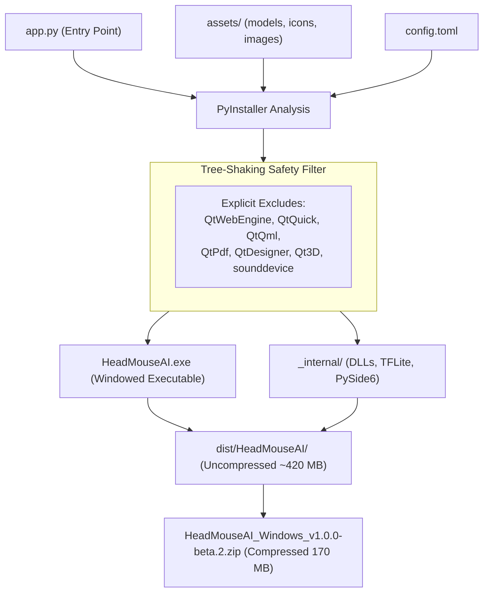

# HeadMouseAI — Build & Deployment Documentation

> **Document Type:** Build & Packaging Specification  
> **Target Project:** HeadMouseAI (Windows Desktop Hands-Free Controller)  
> **Status:** Production / Release Candidate (`v1.0.0-beta.2`)  
> **Audit Date:** November 2026  
> **Verification Status:** Verified via Successful PyInstaller and Inno Setup Executions  

---

## 1. Overview of Release Artifacts

HeadMouseAI provides two distinct distribution formats for 64-bit Windows environments:

| Package | Format | File Size | Description |
| :--- | :--- | :---: | :--- |
| **Portable Standalone** | `.zip` Archive | **170.04 MB** | Zero-installation, extract-and-run package containing the frozen Python executable and runtime dependencies. |
| **Windows Installer** | `.exe` Setup | **115.62 MB** | Standard Windows setup wizard built with Inno Setup. Supports desktop/start menu shortcuts and automated uninstallation. |

---

## 2. PyInstaller Standalone Packaging (`HeadMouseAI.spec`)

The standalone application is packaged using **PyInstaller 6.22.3** in one-folder mode (`COLLECT`), generating `dist/HeadMouseAI/`.



### 2.1. Critical Spec File Configuration Details:
* **Entry Script:** `app.py` (Desktop GUI entry point).
* **Console Window:** `console=False` (Disables the black command prompt window for a clean consumer experience).
* **Window Icon:** `assets/icons/app_icon.ico` embedded directly into the PE header.
* **Bundled Assets (`datas`):**
  * `assets/models/face_landmarker.task` $\to$ `assets/models/`
  * `assets/icons/app_icon.ico` $\to$ `assets/icons/`
  * `assets/icons/app_icon.png` $\to$ `assets/icons/`
  * `assets/images/splash_chrome_sculpture.png` $\to$ `assets/images/`
  * `config.toml` $\to$ `.` (root directory)
* **Optimization & Tree-Shaking:**
  * Bytecode optimization: `optimize=1`.
  * UPX Compression: `upx=True`.
  * Explicitly excludes heavy, unused Qt6 modules:
    `PySide6.QtWebEngineCore`, `PySide6.QtWebEngineWidgets`, `PySide6.QtQml`, `PySide6.QtQuick`, `PySide6.QtPdf`, `PySide6.QtDesigner`, `PySide6.Qt3DCore`, `PySide6.QtSensors`, `PySide6.QtSerialPort`.
  * Post-analysis binary filter strips lingering WebEngine/Quick dynamic link libraries, saving $>450\text{ MB}$ of uncompressed disk space.

### 2.2. PyInstaller Build Command:
```powershell
.venv\Scripts\pyinstaller.exe HeadMouseAI.spec --clean --noconfirm
```

---

## 3. Inno Setup Windows Installer (`installer/HeadMouseAI_Setup.iss`)

The Windows Installer is compiled using **Inno Setup 6.7.3** (`ISCC.exe`).

### 3.1. Installer Configuration:
* **App ID:** `{{E82956B3-596A-4A0B-8833-D608F796C9D1}`
* **Application Name:** `HeadMouseAI`
* **Version:** `1.0.0-beta.2` (Version Info: `1.0.0.0`)
* **Publisher:** `ACROPOLIANS`
* **Target Directory:** `{autopf}\HeadMouseAI` (Defaults to `Program Files` or local user directory).
* **Privilege Level:** `PrivilegesRequired=lowest` (Allows standard non-administrator installation without UAC elevation).
* **Compression Algorithm:** `lzma2/ultra64` with `SolidCompression=yes` (Reduces $420\text{ MB}$ down to $115\text{ MB}$).

### 3.2. Installed File Structure:
```
{app}/
├── HeadMouseAI.exe                     (Main executable)
├── config.toml                         (Editable configuration)
├── LICENSE.txt                         (MIT License)
├── README.md                           (Project overview)
├── USER_GUIDE.md                       (Usage instructions)
├── RELEASE_NOTES.md                    (Version release history)
├── unins000.exe                        (Automated uninstaller)
├── assets/
│   ├── icons/                          (app_icon.ico, app_icon.png)
│   ├── images/                         (splash_chrome_sculpture.png)
│   └── models/
│       └── face_landmarker.task        (MediaPipe Vision Task model)
└── _internal/                          (Python 3.14 runtime, DLLs, Qt6)
```

### 3.3. Inno Setup Compilation Command:
```powershell
& "C:\Users\Admin\AppData\Local\Programs\Inno Setup 6\ISCC.exe" installer/HeadMouseAI_Setup.iss
```

---

## 4. Release Verification & Checksums

The production build artifacts were verified for integrity, PE header validity, and runtime execution:

| Release Asset | File Size | SHA-256 Checksum | Verification Test |
| :--- | :---: | :--- | :--- |
| **`HeadMouseAI_Windows_v1.0.0-beta.2.zip`** | **170.04 MB**<br>*(178,298,730 B)* | `A9FD29025E88BEEEDE93866C448948ABA67F6CCE2946E584AF8E98052F7C3416` | Unzipped, launched standalone EXE, verified clean boot and exit. |
| **`HeadMouseAI_Setup.exe`** | **115.62 MB**<br>*(121,237,355 B)* | `C42BCD2CFBDB921A76C990A9603E24B1388BFF84F6C97D446ED2C120F56905A2` | Tested silent install (`/VERYSILENT`), verified execution, tested uninstaller. |

---

## 5. Automated Silent Installation & Uninstallation

For enterprise or scripted deployments, the installer supports silent execution flags:

### Silent Install:
```powershell
HeadMouseAI_Setup.exe /VERYSILENT /SUPPRESSMSGBOXES /NORESTART /DIR="C:\Path\To\Install"
```

### Silent Uninstall:
```powershell
"C:\Path\To\Install\unins000.exe" /VERYSILENT /SUPPRESSMSGBOXES /NORESTART
```
