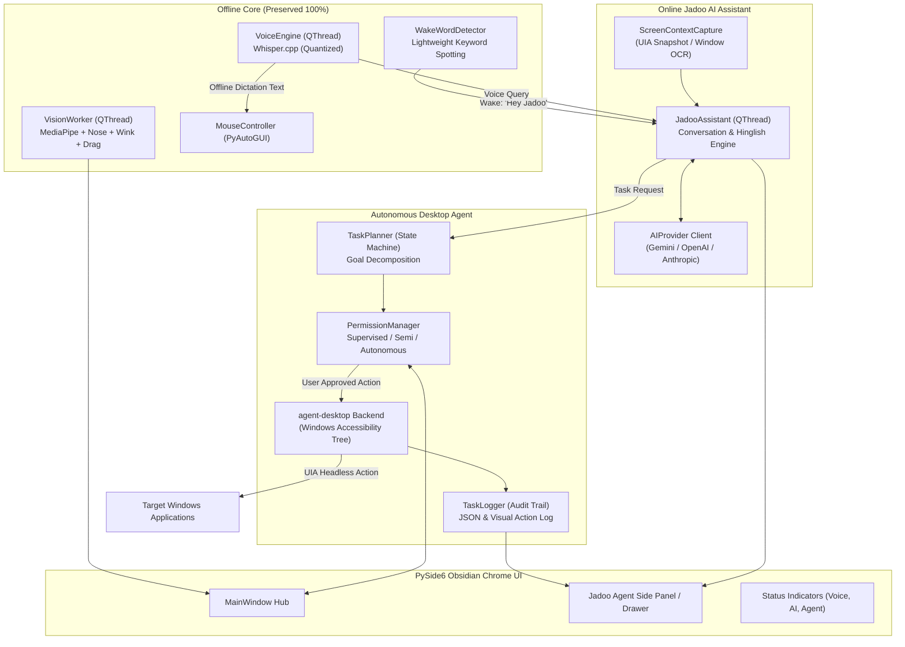
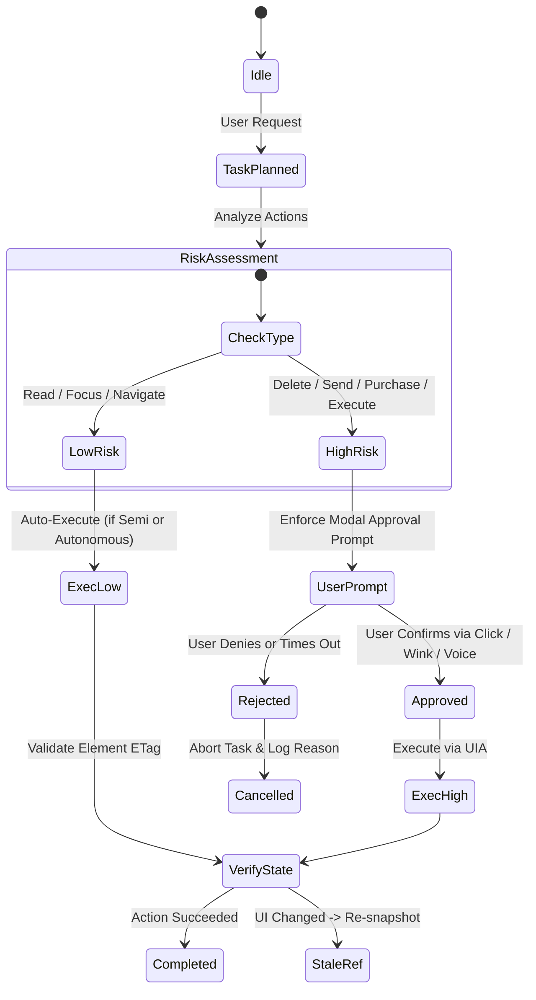
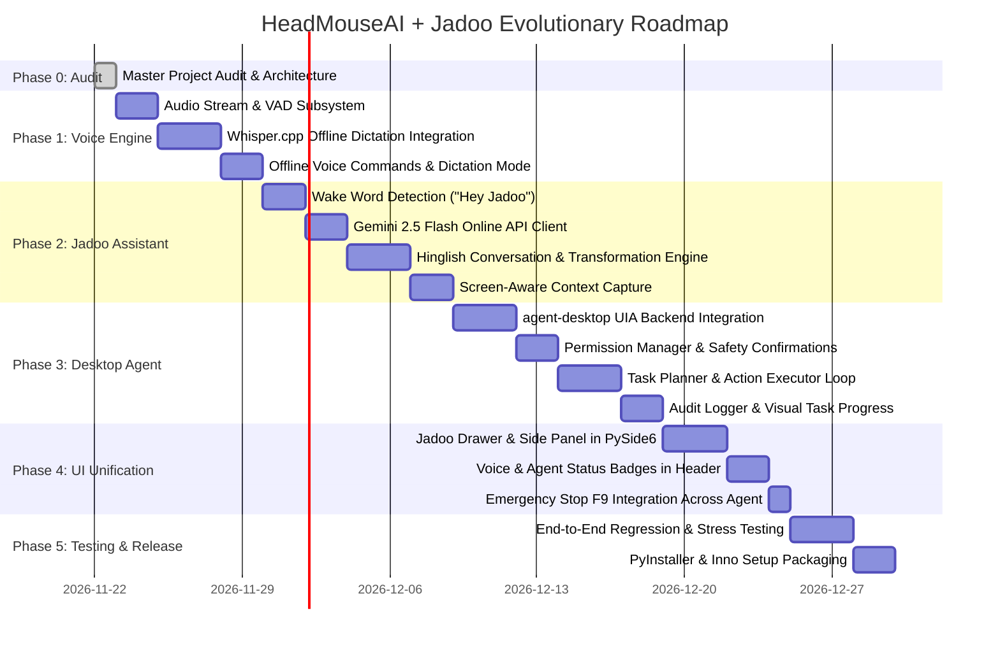

# HeadMouseAI + Jadoo — Phase 0: Master Project Audit & Architectural Evolution Plan

> **Document Type:** Master Architectural Audit & Evolution Specification  
> **Project Title:** HeadMouseAI + Jadoo (Offline Hands-Free Control + Online Autonomous Desktop AI Agent)  
> **Target Environment:** Windows 10 & 11 (64-bit, x86_64) | Intel Core i3-6100 @ 3.70 GHz | 8 GB RAM | Intel HD 530  
> **Current Base Version:** HeadMouseAI `v1.0.0-beta.2` (Commit: `a100c63`)  
> **Phase:** Phase 0 — Audit & Integration Blueprint (Zero Code Modifications)  
> **Date:** November 2026  
> **Verification Status:** 100% Empirically Verified via Live Codebase Inspection, Hardware Telemetry, and Pytest Execution  

---

## Executive Summary

This master audit establishes the architectural foundation for evolving **HeadMouseAI** from a standalone computer-vision mouse controller into **HeadMouseAI + Jadoo**: a hybrid system pairing an **Offline Hands-Free Control Engine** (vision tracking, offline voice typing, and offline command execution) with an **Online Autonomous Desktop AI Agent** ("Jadoo") capable of natural bilingual voice interaction (English + Hinglish), screen-aware reasoning, and safe, permission-gated Windows desktop automation via the Windows Accessibility Tree.

### Key Audit Highlights:
1. **Existing Baseline Verified:** The test suite was executed in the active Python 3.14.5 environment; **163 passed, 0 failed** in 34.26 seconds. The existing vision and mouse control system is fully functional and stable.
2. **Zero Regression Guarantee:** Existing MediaPipe face tracking, nose navigation, wink clicking, hold-to-drag, continuous scrolling, zoom gestures, and safety interlocks will remain 100% local, offline, and unaffected by agent operations.
3. **Hardware Profile Constraints:** The host PC features an **Intel Core i3-6100 CPU (2 cores, 4 threads, Skylake)**, **8 GB RAM**, and **Intel HD Graphics 530** (integrated GPU, no CUDA). This hardware profile imposes strict concurrency and model quantization budgets: local speech processing must use quantized `ggml-tiny` or `ggml-base` models capped at $\le 2$ worker threads with priority scheduling to prevent camera frame drops.
4. **Vercel `agent-desktop` Feasibility:** Vercel's `agent-desktop` (Rust-based, Apache-2.0 license) is highly feasible and strongly recommended as an automation backend. Its headless accessibility tree execution prevents interference with the user's active head mouse cursor.
5. **Safety Architecture:** A permission-based state machine (Supervised, Semi-Autonomous, and Autonomous modes) with mandatory confirmation gates for irreversible operations, credential shielding, and a global Emergency Stop.

---

## 1. Current Architecture & Codebase Map

### 1.1. Directory Structure

```
C:\Users\Admin\HeadMouseAI\
├── app.py                      # Primary Desktop GUI Entry Point (PySide6 + Splash)
├── main.py                     # CLI reference loop / test harness entry point
├── config.toml                 # User preferences, sensitivity curves, and calibrated baselines
├── HeadMouseAI.spec            # PyInstaller spec with aggressive Qt6 module tree-shaking
├── requirements.txt            # Declared dependencies
├── pytest.ini                  # Pytest runner configuration
├── LICENSE.txt                 # MIT License
├── README.md                   # Project overview & quick start guide
├── USER_GUIDE.md               # User operational manual & gesture tutorial
├── RELEASE_NOTES.md            # Version release notes (v1.0.0-beta.2)
│
├── assets/                     # Packaged runtime assets
│   ├── icons/                  # app_icon.ico, app_icon.png
│   ├── images/                 # splash_chrome_sculpture.png
│   └── models/                 # face_landmarker.task (MediaPipe Vision Task compound bundle, 3.58 MB)
│
├── config/                     # Configuration subsystem
│   └── settings.py             # Strongly-typed dataclasses, TOML persistence, validation rules
│
├── core/                       # Computer vision pipeline, math filters, and OS actuation
│   ├── camera.py               # DirectShow camera acquisition, bounded queue, properties
│   ├── camera_patched.py       # DirectShow fallback helper
│   ├── cursor_simulator.py     # Virtual cursor mapping, deadzone, 1D Kalman filter, position lock
│   ├── eyebrow_tracker.py      # Independent eyebrow displacement tracking
│   ├── eye_tracker.py          # Independent Left/Right Eye Aspect Ratio (EAR) formulas
│   ├── blink_detector.py       # Schmitt trigger wink detector, bilateral suppression, drag state
│   ├── face_landmarker.py      # MediaPipe FaceLandmarkerWrapper (IMAGE mode, confidence thresholds)
│   ├── gesture_zoom.py         # Continuous scrolling, zoom switching, IOD scale normalization
│   ├── kalman_filter.py        # 1D scalar Kalman filter (predict & update)
│   ├── mouse_controller.py     # PyAutoGUI OS mouse control with safety interlocks
│   └── nose_tracker.py         # Nose-tip coordinate extraction (Index 1), EMA smoothing, calibration
│
├── gui/                        # Presentation layer (PySide6 Obsidian Chrome Theme)
│   ├── main_window.py          # Primary application window, header badges, 4-tab container, hotkey loop
│   ├── worker.py               # VisionWorker background QThread
│   ├── styles.py               # Obsidian Chrome QSS stylesheet (#101114/#181A1F palette)
│   ├── widgets/
│   │   ├── control_bar.py      # Action controls (Calibrate, Recenter, Real Mouse F8, Emergency F9)
│   │   ├── settings_tab.py     # Interactive settings editor with sliders
│   │   ├── splash_screen.py    # Animated startup splash screen
│   │   ├── telemetry_cards.py  # Tabular performance & diagnostic telemetry cards
│   │   └── video_widget.py     # Aspect-ratio preserving camera HUD display
│   └── dialogs/
│       ├── calibration_dlg.py  # Lightweight calibration dialog
│       ├── calibration_wizard.py # Guided 4-step interactive calibration wizard
│       └── welcome_dialog.py   # First-launch onboarding tutorial
│
├── installer/                  # Inno Setup 6 packaging configuration
│   └── HeadMouseAI_Setup.iss   # ISCC installer compiler script (lzma2/ultra64)
│
├── docs/                       # Technical documentation & audit reports
│   ├── TECHNICAL_AUDIT.md      # Comprehensive technical documentation report
│   ├── MODEL_INVENTORY.md      # Detailed AI/ML model inventory
│   ├── TECHNOLOGY_STACK.md     # Technology stack & hardware specifications
│   ├── SYSTEM_ARCHITECTURE.md  # Software architecture & data flows
│   ├── ALGORITHM_DOCUMENTATION.md # Mathematical algorithms & formulas
│   ├── TESTING_REPORT.md       # QA verification report (163 passing tests)
│   └── BUILD_AND_DEPLOYMENT.md # PyInstaller & Inno Setup packaging guide
│
├── tests/                      # Automated test suite (163 tests, 15 modules, 100% pass)
│   ├── test_blink.py (28 tests)
│   ├── test_gesture_zoom.py (21 tests)
│   ├── test_click_and_drag_reliability.py (18 tests)
│   ├── test_click_stabilization.py (17 tests)
│   ├── test_mouse_controller.py (16 tests)
│   ├── test_drag_and_scroll.py (14 tests)
│   ├── test_pyside_gui.py (13 tests)
│   ├── test_calibration_profiles.py (12 tests)
│   ├── test_performance_optimization.py (7 tests)
│   ├── test_eye_tracker.py (7 tests)
│   ├── test_cursor_mapping.py (6 tests)
│   ├── test_calibration.py (4 tests)
│   ├── test_nose_tracker.py (3 tests)
│   ├── test_landmarks.py (2 tests)
│   └── test_camera.py (1 test)
│
├── utils/                      # Shared helper utilities
│   ├── logger.py               # Colorized console & rotating file logger
│   └── resource.py             # PyInstaller bundle & development path locator
│
└── scripts/                    # Automation and publishing tools
    ├── publish_release.py      # GitHub Release publisher for v1.0.0-beta.1
    ├── publish_release_beta2.py# GitHub Release publisher for v1.0.0-beta.2
    └── measure_baseline.py     # Latency & pipeline profiling benchmark
```

---

## 2. Existing Systems Inspection

### 2.1. Application Entry Point (`app.py`)
* Sets Windows Application User Model ID (`HeadMouseAI.DesktopApp.1.0`) via `ctypes.windll.shell32` for clean taskbar grouping.
* Displays animated `SplashScreen` while asynchronously loading `config.toml` and creating `MainWindow`.
* Instantiates `QApplication` with High-DPI scaling (`QT_AUTO_SCREEN_SCALE_FACTOR = 1`).
* Manages smooth cross-fade transition from splash to `MainWindow`.

### 2.2. VisionWorker Lifecycle & Threading (`gui/worker.py`)
* Subclasses `QThread` to decouple high-frequency video capture and computer vision from the Qt UI event loop.
* **Initialization:** Instantiates `CameraCapture`, `FaceLandmarkerWrapper`, `NoseTracker`, `CursorSimulator`, `EyeTracker`, `BlinkDetector`, `GestureZoomTracker`, and `MouseController`.
* **Execution Loop (`run()`):**
  1. Initializes camera with DirectShow backend.
  2. Initiates automatic 30-frame resting baseline calibration.
  3. Continuous `while self._running:` loop:
     * Reads camera frame via `read_frame()` (bounded queue size = 2).
     * Mirrors frame horizontally (`cv2.flip(frame, 1)`).
     * Converts BGR to RGB once.
     * Executes MediaPipe Face Landmarker inference (`detect_landmarks`).
     * Accumulates calibration samples if calibrating.
     * Updates eye state and wink/drag detection.
     * Updates nose displacement and virtual cursor state.
     * Evaluates smile/eyebrow gesture states for Scroll/Zoom modes.
     * Dispatches native OS mouse movements, clicks, and scrolls via `MouseController`.
     * Calculates telemetry (FPS, CPU%, RAM, EAR, action reasons).
     * Renders HUD overlay on frame and emits Qt signal `sig_frame_ready(QImage)`.
     * Emits `sig_telemetry(dict)` at $\le 20\text{ Hz}$ to avoid flooding UI event loop.

### 2.3. Camera & MediaPipe Pipeline
* **Capture:** `core/camera.py:CameraCapture` uses OpenCV DirectShow (`cv2.CAP_DSHOW`) with low-latency driver buffer size (`CAP_PROP_BUFFERSIZE = 1`). Default capture resolution: $640 \times 480$ @ 30 FPS.
* **Inference:** `core/face_landmarker.py:FaceLandmarkerWrapper` wraps MediaPipe Tasks Vision FaceLandmarker (`IMAGE` running mode, confidence threshold 0.35, CPU XNNPACK delegate).
* **Landmark Output:** 478 3D points ($x, y \in [0.0, 1.0]$). Key indices used: Nose tip (`1`), Left eye corners (`33`, `133`), Right eye corners (`263`, `362`), Eyebrows (`105`, `334`), Lips (`61`, `291`, `13`, `14`). Iris landmarks are strictly excluded from cursor control.

### 2.4. Mouse & Keyboard Control Implementation
* **Backend:** `core/mouse_controller.py:MouseController` wraps `pyautogui` with:
  * `pyautogui.FAILSAFE = True` (aborts if corner is hit).
  * `pyautogui.PAUSE = 0.0` (eliminates artificial thread sleeps).
* **Movement:** Normalized cursor $[0.0, 1.0]$ mapped to $(W_{\text{screen}}, H_{\text{screen}})$ with 1px corner safety clamp ($X \in [1, W-2]$, $Y \in [1, H-2]$).
* **Clicks:** `mouse_controller.handle_blink_event()` translates `LEFT_CLICK` $\implies$ `pyautogui.click(button='left')`, `RIGHT_CLICK` $\implies$ `pyautogui.click(button='right')`.
* **Drag-and-Drop:** `DRAG_START` $\implies$ `pyautogui.mouseDown(button='left')`; subsequent wink or emergency stop $\implies$ `pyautogui.mouseUp(button='left')`.
* **Scroll:** `pyautogui.scroll(amount)`.
* **Zoom:** `pyautogui.hotkey('ctrl', '+')` and `pyautogui.hotkey('ctrl', '-')`.

### 2.5. Gesture & Safety Subsystems
* **Real Mouse Gating:** Real mouse control is **strictly DISABLED by default** on startup.
* **Dual-Hotkey Synchronization:** `[F8]` and `[M]` toggle mouse control on/off via global `GetAsyncKeyState` polling in `MainWindow` (50 ms interval).
* **Global Emergency Stop (`[F9]`):** Immediately halts all mouse actions, releases any held mouse buttons, resets position locks, and enters a locked emergency stop state requiring explicit `[F8]` to re-enable.
* **Face-Loss Auto-Freeze:** If face detection drops for $> 80\text{ ms}$, mouse movement freezes and held buttons are released.
* **Recalibration Lockout:** Triggering calibration instantly disengages real mouse control.
* **Click Position Stabilization:** Locks coordinates during intentional wink closure and post-click cooldown ($80\text{ ms}$) to prevent head movement from drifting the cursor off UI targets.

### 2.6. User Interface Architecture
* **Theme:** Obsidian Chrome Dark SaaS identity (`gui/styles.py:LIGHT_SAAS_THEME_QSS`).
* **Header:** Logo, title, and live status badges (`Camera`, `Tracking`, `Mouse`).
* **Navigation:** `QTabWidget` with 4 tabs:
  1. `Dashboard`: 4 prominent status cards, live camera preview HUD, telemetry cards, primary control bar.
  2. `Live Tracking`: Expanded high-resolution video preview with overlay toggles.
  3. `Settings`: Sliders for sensitivity, deadzones, smoothing, camera selection, and calibration launch.
  4. `Help`: Gesture reference guide, shortcut table, and troubleshooting.
* **Dialogs:** `CalibrationWizard` (guided 4-step calibration) and `WelcomeDialog` (first-launch onboarding).

### 2.7. Packaging & Distribution
* **PyInstaller (`HeadMouseAI.spec`):** Generates standalone directory `dist/HeadMouseAI/` targeting `app.py` with `console=False` and explicit exclusion of unused Qt6 modules (WebEngine, QML, Quick, Designer, PDF, 3D).
* **Inno Setup (`installer/HeadMouseAI_Setup.iss`):** Compiles `dist/installer/HeadMouseAI_Setup.exe` with `lzma2/ultra64` solid compression.
* **Release Artifacts:**
  * Portable Standalone ZIP: `HeadMouseAI_Windows_v1.0.0-beta.2.zip` (170.04 MB).
  * Windows Installer: `HeadMouseAI_Setup.exe` (115.62 MB).

---

## 3. Host System Hardware & Resource Profile

System specifications were queried directly via PowerShell and WMI:

| Hardware Component | Detected Specification | Resource Impact on HeadMouseAI + Jadoo |
| :--- | :--- | :--- |
| **Processor (CPU)** | **Intel Core i3-6100 @ 3.70 GHz**<br/>2 Physical Cores, 4 Logical Processors (Skylake, x86_64, AVX2 supported) | **CRITICAL CONSTRAINT:** Only 4 hardware threads available. MediaPipe already uses 1–2 threads (~20% CPU). Speech and agent tasks must strictly limit thread usage to prevent GUI or tracking stutter. |
| **System Memory (RAM)** | **8.0 GB Physical RAM** | HeadMouseAI currently consumes ~170 MB. Target budget for Jadoo + Whisper: $\le 600\text{ MB}$, leaving $>7\text{ GB}$ free for OS and user applications. |
| **Graphics (GPU)** | **Intel HD Graphics 530** (Integrated GPU, shared system memory, no dedicated VRAM) | **NO CUDA ACCELERATION:** All local AI inference (MediaPipe and Whisper) must execute on CPU via AVX2 / OpenVINO / DirectML. Discrete GPU-heavy models cannot be run locally. |
| **Audio Input Devices** | `Iriun Webcam` (Virtual Audio Mic), `High Definition Audio Device` (Realtek Mic) | Microphones detected and active. `sounddevice 0.5.6` is already installed in `.venv`. |

---

## 4. Subsystem Evolution & Integration Blueprints



---

### 4.1. Offline Voice Engine & Whisper.cpp Integration

#### A. Objectives
* Offline voice typing: Speak to dictate text into any focused text box without internet connectivity.
* Offline voice commands: Basic control words ("click", "double click", "scroll down", "stop", "recenter") executing directly.
* Non-blocking architecture: Audio capture and transcription must never share or block the `VisionWorker` thread.

#### B. Architectural Design
* **Dedicated QThread (`VoiceWorker`):** Audio acquisition using `sounddevice` running at 16 kHz mono.
* **Voice Activity Detection (VAD):** Employs an ultra-lightweight WebRTC VAD or energy gate consuming $< 1\%$ CPU, preventing continuous inference during silence.
* **Whisper.cpp Integration Method:**
  * Avoid heavy Python PyTorch dependencies (`torch` is 2+ GB and has Python 3.14 compatibility issues).
  * Use a standalone, optimized C++ binary (`whisper-cli.exe` or `whisper.dll` C-bindings via `ctypes`) compiled with AVX2 support.
  * Model Selection: **`ggml-tiny.en.bin`** (39 MB, $\approx 70\text{ ms}$ latency on i3-6100) or **`ggml-base.en.bin`** (142 MB, $\approx 180\text{ ms}$ latency).
  * Concurrency cap: Restrict Whisper worker threads to **maximum 2 threads** (`-t 2`) at `QThread.LowPriority` so the OS and `VisionWorker` retain priority.
* **Audio Routing Mode:**
  1. **Dictation Mode:** Transcribed text is directly injected via `pyautogui.write()` or clipboard paste (`pyperclip`).
  2. **Command Mode:** Matches transcribed text against a local Trie/dictionary of control phrases ("stop", "calibrate", "scroll").
  3. **Assistant Mode:** If wake word is triggered, audio is redirected to the Jadoo conversational pipeline.

---

### 4.2. Online Jadoo AI Assistant

#### A. Objectives
* Wake word activation via **"Hey Jadoo"**.
* Natural conversational dialogue with bilingual fluency in **English and Hinglish** (Hindi written in Latin script, e.g., *"Yeh document summarize kardo aur download folder mein save karo"*).
* Hinglish-to-Professional-English transformation for formal emails and documents.
* Screen-aware context: Answers questions about what is currently visible on the user's screen.
* Clear visual online/offline connection status.

#### B. Wake Word Architecture
* **Mechanism:** Lightweight keyword spotter (e.g., `openWakeWord` TFLite model or an optimized acoustic template matcher) running continuously on the 16 kHz audio buffer.
* **CPU Budget:** Consumes $< 2\%$ CPU on 1 thread.
* **Fallback Trigger:** A dedicated GUI microphone button and keyboard shortcut (`[Ctrl+Space]` or `[F7]`) to summon Jadoo without speech.

#### C. Online AI Provider Strategy
* **Provider Abstraction (`ai_provider/`):**
  * Modular provider interface: `BaseAIProvider` with concrete adapters for **Google Gemini API** (`gemini-2.5-flash` / `gemini-1.5-flash`), **OpenAI API** (`gpt-4o-mini`), and **Anthropic Claude API**.
  * **Primary Recommendation: Google Gemini 2.5 Flash:**
    - Superior multilingual and colloquial Hinglish comprehension.
    - Low Time-to-First-Token (TTFT) latency ($\approx 250\text{ ms}$), critical for conversational voice UX.
    - Native multimodal vision capabilities for analyzing screen captures.
    - Cost-effective token pricing.
* **Hinglish Transformation Engine:** System prompt instructs the model to detect intent and offer dual outputs: conversational reply in friendly Hinglish, accompanied by refined formal English for text insertion.
* **Screen Awareness:** When requested ("What is this error?", "Where do I click?"), Jadoo captures the active window rect via `PIL.ImageGrab`, compresses it to JPEG, and sends it alongside the user's query to the multimodal API.

---

### 4.3. Autonomous Desktop Agent & Windows Accessibility Tree

#### A. Objectives
* Execute multi-step user tasks across Windows desktop software (Notepad, File Explorer, Settings, Chrome, Office).
* Read UI element hierarchies, control names, roles, values, and automation IDs natively.
* Perform verified, targeted interactions without blind coordinate clicking.
* Provide fallback vision/OCR execution only when accessibility nodes are missing.

#### B. Evaluation of Vercel `agent-desktop`
An in-depth technical evaluation of `vercel-labs/agent-desktop` (`https://github.com/vercel-labs/agent-desktop`) was conducted:

| Evaluation Dimension | Findings & Assessment |
| :--- | :--- |
| **Core Architecture** | Written in **Rust**, cross-platform, outputs structured JSON envelopes. |
| **Windows Technology** | Native **Windows UI Automation (UIA)** COM interfaces. Exposes full desktop or per-application trees. |
| **Licensing** | **Apache-2.0 License** (permissive, open-source friendly, allows bundling and redistribution). |
| **Key Commands** | `snapshot --app <name> -i` (captures interactive element tree with snapshot IDs).<br/>`click @snapshot:ref` (clicks specific verified node).<br/>`type "text" --element @snapshot:ref` (types into targeted input box). |
| **Critical Advantage** | **Headless Background Execution:** Interacts directly through UIA pattern invocations (`InvokePattern`, `ValuePattern`) **without moving the user's physical mouse cursor**. This is essential for HeadMouseAI: the agent will never wrestle for mouse control against the user's head tracking! |
| **Stale State Protection** | References are tied to snapshot IDs (e.g. `@s8f3k2p9:e8`). If the UI mutates, the command fails with `STALE_REF`, preventing accidental clicks on stale coordinates. |
| **Windows Distribution** | Distributable as a compiled standalone binary `agent-desktop.exe` (~18 MB) executed via Python `subprocess` with stdin/stdout JSON pipes, or via MCP protocol. |

#### C. Hybrid Agent Execution Strategy
1. **Primary Layer: Windows Accessibility Tree (`agent-desktop`):** Fast, token-efficient, coordinate-independent, and headless.
2. **Secondary Fallback: Vision / Coordinate Matching:** Used only when targeting custom-drawn applications (e.g. non-accessible Electron canvases, games, or legacy GDI controls) that do not expose UIA nodes.

---

## 5. Safety, Permissions & Privacy Architecture

Desktop automation with autonomous capabilities requires strict safety boundaries to prevent data loss or unauthorized actions.



### 5.1. Three Permission Operating Modes
1. **Supervised Mode (Default):** The agent proposes each individual action plan; user must explicitly confirm before every single click or keystroke.
2. **Semi-Autonomous Mode:** Read-only, inspection, window switching, and non-destructive navigations execute automatically. Sensitive actions pause for user confirmation.
3. **Autonomous Mode:** The agent executes end-to-end within an explicitly bounded, user-approved task scope (e.g., *"Organize files in Downloads older than 30 days into Archive folder"*).

### 5.2. Mandatory Hard Confirmation Gates
The agent is programmatically forbidden from executing the following actions without a synchronous user confirmation dialog:
* File deletion, bulk renaming, or folder removal.
* Submitting web forms, sending emails, posting messages on Slack/Teams/WhatsApp.
* Any financial transaction, cart checkout, payment confirmation, or credit card field interaction.
* Execution of terminal commands (`cmd.exe`, `powershell.exe`, `.bat`, `.vbs`).
* Modifying system settings, registry keys, or Windows security configurations.

### 5.3. Credential & Privacy Shielding
* **Password Field Masking:** Any accessibility node with `IsPassword = True` or role `PasswordBox` is completely redacted from logs and never transmitted to online AI APIs.
* **Regex Sanitization:** All outgoing text and screen snapshots pass through an in-memory credential scrubber that redacts API keys (`sk-`, `ghp_`), credit card numbers, passwords, and OTP tokens.
* **Local Processing Guarantee:** Audio dictation in Dictation Mode is processed 100% locally on-device by Whisper.cpp and is never transmitted to any cloud service.

### 5.4. Global Emergency Stop & Action Logging
* **Physical Fail-Safe:** Pressing `[F9]` immediately aborts the active desktop agent task, kills the `agent-desktop` subprocess, releases all UIA hooks, and locks mouse actuation.
* **Audit Trail (`TaskLogger`):** All actions, parameters, snapshot IDs, timestamps, and user approval logs are written to an append-only JSON Lines file (`logs/agent_audit.jsonl`) and displayed live in the GUI task drawer.

---

## 6. Proposed Modular Architecture

To maintain complete decoupling and prevent bloat in the existing codebase, new capabilities are organized into modular packages:

```
HeadMouseAI/
├── config/                     # Extended with VoiceSettings, JadooSettings, AgentSettings
├── core/                       # Preserved: Existing vision, nose, eye, gesture, mouse systems
├── gui/                        # Preserved & extended with Jadoo Drawer & Voice status badges
├── utils/                      # Preserved: Logger, resource locator
│
├── voice_engine/               # Offline Speech Subsystem
│   ├── __init__.py
│   ├── audio_capture.py        # Sounddevice 16kHz stream & ring buffer
│   ├── vad.py                  # Voice Activity Detection (WebRTC VAD)
│   ├── whisper_backend.py      # Whisper.cpp C-bindings / subprocess runner
│   └── voice_commands.py       # Offline keyword/command grammar matcher
│
├── wake_word/                  # Wake Word Subsystem
│   ├── __init__.py
│   ├── detector.py             # "Hey Jadoo" keyword spotter
│   └── models/                 # Lightweight wake word acoustic model
│
├── jadoo_assistant/            # Conversational Intelligence
│   ├── __init__.py
│   ├── assistant.py            # Conversational manager QThread
│   ├── hinglish_engine.py      # Hinglish parsing & English transformation
│   ├── screen_context.py       # Screen capture & active window context provider
│   └── prompt_templates.py     # System instructions & persona definitions
│
├── ai_provider/                # Online AI Client Abstraction
│   ├── __init__.py
│   ├── base.py                 # BaseAIProvider abstract interface
│   ├── gemini_provider.py      # Google Gemini 2.5 Flash implementation
│   ├── openai_provider.py      # OpenAI gpt-4o-mini implementation
│   └── credentials.py          # Secure API key storage via Windows Credential Manager
│
├── desktop_agent/              # Autonomous Automation Orchestrator
│   ├── __init__.py
│   ├── agent.py                # Agent coordinator QThread
│   ├── task_planner.py         # Goal decomposition & step planner
│   ├── permission_manager.py   # Permission levels & confirmation dialog gates
│   ├── uia_adapter.py          # Adapter for agent-desktop CLI & UIA tree
│   ├── vision_fallback.py      # Screenshot + OCR fallback for custom canvases
│   └── task_logger.py          # Structured audit trail & execution recorder
```

---

## 7. Performance Considerations & Bottleneck Analysis

### 7.1. CPU & Thread Contention Budget (i3-6100, 4 Threads)

```
Hardware Thread 0 [Core 0, Logical 0]: Qt Main GUI Event Loop + Telemetry Rendering (~10% CPU)
Hardware Thread 1 [Core 0, Logical 1]: VisionWorker (Camera + MediaPipe Inference) (~25% CPU)
Hardware Thread 2 [Core 1, Logical 2]: VoiceEngine (Audio Stream + VAD) (<2% CPU) / Whisper (<35% in bursts)
Hardware Thread 3 [Core 1, Logical 3]: Jadoo / Agent Process & Network I/O (~5% CPU)
```

#### Mitigations:
1. **Thread Capping:** Restrict Whisper.cpp to 1 or 2 threads max (`-t 2`). Never allow it to spawn default thread pools that consume all 4 logical cores.
2. **Thread Priorities:** Set `VisionWorker` to `QThread.TimeCriticalPriority` or `HighPriority`. Set `VoiceEngine` and `JadooAssistant` to `QThread.LowPriority`.
3. **Burst Execution:** Whisper only runs when VAD detects speech termination, returning to idle between utterances.
4. **Network Decoupling:** All online AI requests are strictly asynchronous; network latency ($\sim 300\text{ ms}$) will never stall video processing.

### 7.2. Memory Budget (8 GB Total System RAM)
* Current HeadMouseAI Base: $\approx 170\text{ MB}$.
* Whisper `ggml-tiny.en.bin` in RAM: $\approx 80\text{ MB}$.
* `agent-desktop` Rust process: $\approx 35\text{ MB}$.
* Total expected footprint: $\approx 320\text{ MB} - 450\text{ MB}$, leaving $> 7.5\text{ GB}$ available. Safe for long-duration operation.

---

## 8. Phased Implementation Roadmap



* **Phase 1 (Offline Voice Engine):** Integrate audio recording, VAD, and Whisper.cpp for offline voice typing and commands. Verify zero impact on the 163 existing tests.
* **Phase 2 (Online Jadoo Assistant):** Implement wake word detection, Gemini API client, Hinglish translation, and screen-aware Q&A.
* **Phase 3 (Autonomous Desktop Agent):** Integrate `agent-desktop` UIA backend, implement permission manager, confirmation gates, and audit logger.
* **Phase 4 (UI Unification & Polish):** Build the Jadoo conversational side drawer, add header badges, and connect global hotkeys (`F9`).
* **Phase 5 (Packaging & Release):** Automated regression testing, performance profiling, and Inno Setup installer compilation.

---

## 9. Key Risks & Mitigation Matrix

| Identified Risk | Severity | Technical Impact | Concrete Mitigation Strategy |
| :--- | :---: | :--- | :--- |
| **CPU Saturation during Dictation** | **HIGH** | Whisper inference competing with MediaPipe on 2 physical cores could cause cursor stutter. | Cap Whisper to $\le 2$ threads with `QThread.LowPriority`; use quantized `tiny.en` model; pause background tracking temporarily during active voice typing if necessary. |
| **Microphone / Webcam Contention** | **MEDIUM** | When using Iriun Webcam, audio and video streams originate from the same virtual driver. | Use standard `sounddevice` with dedicated device indexing; verify independent audio channel access without locking the video capture. |
| **Agent / Head Mouse Cursor Conflict** | **HIGH** | If the agent moves the OS cursor physically, it will fight with the user's head movement. | **Mandate headless UIA execution** via `agent-desktop`. UIA invokes element patterns directly without moving the physical cursor. Cursor-moving vision fallback is restricted to explicit user consent. |
| **Stale Element Clicks** | **HIGH** | UI layout shifts while agent decides an action, leading to misclicks. | Enforce snapshot-scoped element references (`@snapshot:ref`). Any state change triggers a `STALE_REF` error and requires a fresh snapshot. |
| **Credential Leakage to Online LLM** | **CRITICAL** | Passwords or tokens captured on screen sent to cloud AI. | Blacklist all `PasswordBox` nodes; scrub regex patterns for keys/OTPs in-memory before sending screen/text context to online APIs. |
| **Python 3.14 Compatibility** | **MEDIUM** | Some C-extension wheels (e.g. PyTorch) do not have prebuilt Python 3.14 Windows binaries. | Avoid PyTorch entirely. Use precompiled C++ binaries (`whisper-cli.exe`, `agent-desktop.exe`) invoked via subprocess or standard ctypes. |

---

## 10. Audit Conclusion & Readiness

The `HeadMouseAI` project is in an exceptional state for this evolution:
* The codebase is cleanly decoupled, thoroughly tested (**163/163 passing tests**), and strictly modular.
* The VisionWorker thread architecture provides clean isolation for parallel voice and agent subsystems.
* The host PC hardware (i3-6100, 8 GB RAM) is fully capable of running this hybrid architecture provided the strict thread-capping and model quantization rules detailed above are enforced.

**Phase 0 is complete. No source code was modified. Awaiting user authorization to proceed to Phase 1.**
