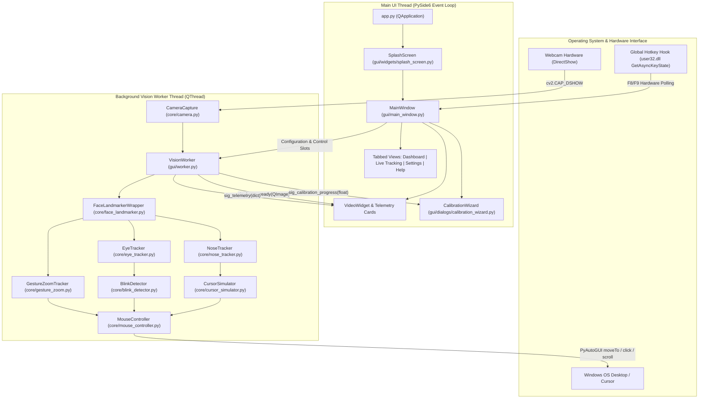
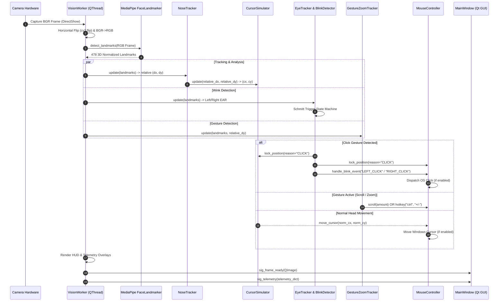

# HeadMouseAI — Software Architecture & System Design

> **Document Type:** System Architecture Specification  
> **Target Project:** HeadMouseAI (Windows Desktop Hands-Free Controller)  
> **Status:** Production / Release Candidate (`v1.0.0-beta.2`)  
> **Audit Date:** November 2026  
> **Verification Status:** 100% Grounded in Repository Code Inspection  

---

## 1. High-Level Architectural Overview

HeadMouseAI employs a **decoupled, multi-threaded pipeline architecture** designed to ensure that continuous computer vision acquisition, neural network inference, and OS input dispatching never block or degrade the responsiveness of the graphical user interface.

---

## 2. Application Entry Points

The codebase provides two distinct execution entry points tailored for different runtime targets:

### 2.1. Desktop Windowed Application: `app.py` (Primary Entry Point)
* **Target Audience:** End-users and PyInstaller production distribution.
* **Role:**
  * Configures Windows high-DPI scaling (`QT_AUTO_SCREEN_SCALE_FACTOR = 1`).
  * Registers a unique Windows Application User Model ID (`HeadMouseAI.DesktopApp.1.0`) via `ctypes.windll.shell32` to ensure correct taskbar pinning and icon association.
  * Launches an animated dark-theme `SplashScreen` showing step-by-step subsystem initialization:
    1. Loading configuration and user preferences from `config.toml`.
    2. Initializing AI models and DirectShow camera capture.
    3. Launching `MainWindow` with a smooth 1.6-second cross-fade.
  * Handles graceful startup exceptions with native `QMessageBox.critical` alerts.

### 2.2. CLI Reference Implementation: `main.py`
* **Target Audience:** Headless server testing, automated verification scripts, and developer benchmarking.
* **Role:**
  * Instantiates `HeadMouseApp`, executing a pure OpenCV `cv2.imshow` window loop without Qt dependencies.
  * Demonstrates baseline nose tracking, eye EAR calculations, and keyboard event polling (`cv2.waitKey`).
  * Maintained for backward compatibility with automated unit tests and benchmark harnesses (`benchmark_results.json`).

---

## 3. Multi-Threaded Concurrency Model

### 3.1. Thread Separation
* **Thread 1: UI Event Loop (Qt Main Thread):**
  * Manages the PySide6 event loop, layout calculations, high-DPI UI rendering, user interactions, settings adjustments, and calibration dialogs.
  * Runs a 50 ms polling timer (`_hotkey_timer`) querying `GetAsyncKeyState` for global `F8` (Real Mouse Toggle) and `F9` (Emergency Stop) hotkeys.
* **Thread 2: Vision Worker (`gui/worker.py:VisionWorker` subclassing `QThread`):**
  * Continuously captures video frames from the camera using a bounded 2-frame buffer.
  * Converts frames from BGR to RGB (with zero redundant conversions).
  * Executes MediaPipe Face Landmarker inference (`FaceLandmarkerWrapper`).
  * Computes nose coordinates, eye EAR ratios, Schmitt trigger blink states, and smile/eyebrow gestures.
  * Directly invokes OS-level cursor movements and clicks via `MouseController` using PyAutoGUI.
  * Renders tracking overlays (face mesh, nose vector, bounding boxes, state text) onto the frame, converts it to a Qt `QImage`, and emits it to the UI thread.

### 3.2. Inter-Thread Communication (Qt Signals & Slots)

All inter-thread communication uses Qt's thread-safe **Queued Connection** signal-slot architecture:

| Signal Name | Payload Type | Direction | Purpose |
| :--- | :--- | :--- | :--- |
| `sig_frame_ready` | `QImage` | Worker $\to$ UI | Sends rendered preview frame for display on `VideoWidget` |
| `sig_telemetry` | `dict` | Worker $\to$ UI | Emits live telemetry (FPS, CPU%, RAM, EAR, state, coordinates) |
| `sig_mouse_state_changed` | `bool, str` | Worker $\to$ UI | Signals mouse state transition (e.g. `(True, "ENABLED")`) |
| `sig_calibration_progress` | `float` | Worker $\to$ UI | Broadcasts wizard calibration progress ($0.0 \to 1.0$) |
| `sig_calibration_complete` | None | Worker $\to$ UI | Signals completion of 4-step baseline calibration |
| `sig_status_message` | `str, str` | Worker $\to$ UI | Logs status bar notifications (`(level, text)`) |
| `sig_alert` | `str, str` | Worker $\to$ UI | Triggers critical UI modal dialogs (e.g. camera disconnected) |

---

## 4. End-to-End Pipeline Execution Sequence

---

## 5. Core Module Directory Structure & Responsibilities

### 5.1. `core/` — Vision, Math & Control Subsystems
* **`camera.py` (`CameraCapture`):** Manages camera lifecycle, DirectShow backend negotiation, camera property controls, and bounded frame queueing.
* **`face_landmarker.py` (`FaceLandmarkerWrapper`):** Wraps MediaPipe Vision Tasks API; manages the `face_landmarker.task` model file.
* **`nose_tracker.py` (`NoseTracker`):** Extracts nose-tip coordinate (Index 1), applies Exponential Moving Average (EMA) smoothing, maintains resting baseline calibration, and computes displacement $(\Delta x, \Delta y)$.
* **`cursor_simulator.py` (`CursorSimulator`):** Converts nose displacement into virtual cursor coordinates with radial dead-zone filtering, sensitivity multipliers, 1D Kalman smoothing, boundary clamping, and click position stabilization locks.
* **`eye_tracker.py` (`EyeTracker`):** Calculates canonical 6-point Euclidean Eye Aspect Ratio ($\text{EAR}$) independently for left and right eyes.
* **`blink_detector.py` (`BlinkDetector`, `SingleEyeTracker`):** Dual-eye Schmitt trigger hysteresis state machine with bilateral blink suppression, dwell-based drag-and-drop ($>0.38\text{ s}$), and click stabilization.
* **`gesture_zoom.py` (`GestureZoomTracker`):** Scale-invariant mouth and eyebrow gesture tracker utilizing Inter-Ocular Distance (IOD) normalization to manage mutually-exclusive continuous Scroll Mode and Zoom Mode.
* **`mouse_controller.py` (`MouseController`):** Real Windows OS mouse controller using PyAutoGUI with strict safety gating (disabled by default, `F8` toggle, `F9` emergency stop, face-loss auto-freeze, recalibration lockout).
* **`kalman_filter.py` (`KalmanFilter1D`):** Scalar Kalman filter incorporating prediction and measurement updates for smooth, jitter-free cursor motion.

### 5.2. `gui/` — Presentation & Interface Layer
* **`main_window.py` (`MainWindow`):** Central Obsidian Chrome desktop application window, header status indicators, 4-tab container, global hotkey polling loop, and system tray integration.
* **`styles.py` (`LIGHT_SAAS_THEME_QSS`):** Comprehensive Qt Style Sheet (QSS) implementing the Obsidian Chrome visual identity (#101114 / #181A1F dark palette, metallic borders, emerald/amber/crimson status indicators).
* **`worker.py` (`VisionWorker`):** Background worker thread orchestrating the vision-to-actuation pipeline.
* **`widgets/video_widget.py` (`VideoWidget`):** Custom camera rendering widget supporting aspect-ratio preserving display, blurred background framing, and dynamic gesture action banners.
* **`widgets/telemetry_cards.py` (`TelemetryCardsWidget`):** Tabular performance monitor displaying real-time FPS, CPU%, RAM, EAR values, tracking states, and rejection reasons.
* **`widgets/control_bar.py` (`ControlBarWidget`):** Primary action bar with Calibrate, Recenter, Real Mouse Toggle, and Emergency Stop controls.
* **`widgets/settings_tab.py` (`SettingsTabWidget`):** Complete user preference editor with sliders, camera selector, sensitivity adjustments, and reset controls.
* **`widgets/splash_screen.py` (`SplashScreen`):** Animated startup splash screen with metallic typography and subsystem initialization progress.
* **`dialogs/calibration_wizard.py` (`CalibrationWizard`):** Guided 4-step calibration dialog with live camera preview (Neutral Center, Eye Baselines, Eyebrows & Mouth).
* **`dialogs/welcome_dialog.py` (`WelcomeDialog`):** Interactive onboarding guide presented on first launch.

### 5.3. `config/` — Data Models & Serialization
* **`settings.py` (`AppSettings`, etc.):** Strongly-typed Python dataclasses defining all configuration parameters with validation, boundary clamping, and TOML persistence (`config.toml`).

### 5.4. `utils/` — Common Utilities
* **`logger.py` (`logger`):** Color-formatted log engine writing simultaneously to stdout and daily rolling log files in `logs/`.
* **`resource.py` (`get_resource_path`, `get_model_path`, `get_icon_path`):** Robust path resolution helper supporting both development mode and PyInstaller frozen bundle environments (`sys._MEIPASS`).
