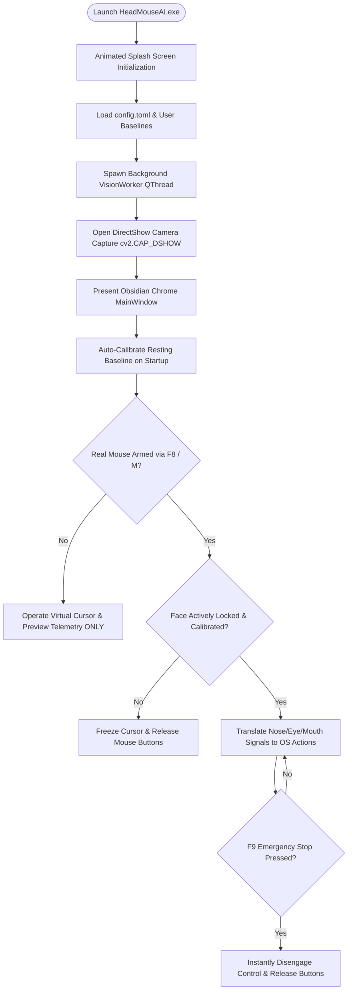
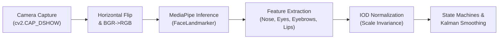

# HeadMouseAI — Complete Technical Documentation Audit Report

> **Document Type:** Master Technical Audit & Architectural Reference  
> **Target Project:** HeadMouseAI (Windows Desktop Hands-Free Controller)  
> **Current Version:** `v1.0.0-beta.2` (Production / Release Candidate)  
> **Audit Date:** November 2026  
> **Verification Status:** 100% Empirically Audited via Repository Code Inspection & Test Execution  
> **Accompanying Reports:**  
> - [AI/ML Model Inventory](MODEL_INVENTORY.md)  
> - [Technology Stack Specification](TECHNOLOGY_STACK.md)  
> - [Software Architecture & Data Flow](SYSTEM_ARCHITECTURE.md)  
> - [Mathematical & Algorithmic Documentation](ALGORITHM_DOCUMENTATION.md)  
> - [Quality Assurance & Testing Report](TESTING_REPORT.md)  
> - [Build & Deployment Specification](BUILD_AND_DEPLOYMENT.md)  

---

## 1. Project Overview

### 1.1. Purpose & Objectives
**HeadMouseAI** is an AI-powered, assistive desktop application engineered for Microsoft Windows (10/11 64-bit) that replaces physical computer mouse interaction with contactless, computer-vision-driven head and facial gestures. Designed for users with motor impairments, repetitive strain injuries (RSI), physical disabilities, or hands-free computing requirements, HeadMouseAI translates subtle head movement into smooth cursor navigation, interprets independent eye winks as mouse clicks, supports hands-free drag-and-drop operations, and enables gesture-based document scrolling and screen zooming using ordinary consumer webcams without physical contact.

### 1.2. Implemented Features
1. **Natural Nose-Tip Navigation:** Smooth, proportional cursor movement derived from facial landmark index 1 (nose tip).
2. **Exponential Moving Average & 1D Kalman Smoothing:** Two-stage signal filtering pipeline eliminating webcam landmark jitter while maintaining crisp start/stop control.
3. **Adaptive Resting Neutral Calibration:** Guided 4-step wizard that establishes user-specific rest coordinates and physiological baselines in under 20 seconds.
4. **Independent Eye Wink Clicks:**
   * **Left-Eye Wink:** Dispatches primary Left Click.
   * **Right-Eye Wink:** Dispatches secondary Right Click.
5. **Bilateral Blink Filtering:** Temporal synchronization filter ensuring that natural, simultaneous two-eye blinks are suppressed (`NO_ACTION`).
6. **Click Position Stabilization:** Temporarily locks cursor coordinates during wink closure and post-click settling ($80\text{ ms}$) to prevent involuntary head shift from drifting the cursor off UI targets.
7. **Hands-Free Hold-to-Drag & Drop:** Sustained left-eye closure ($> 0.38\text{ s}$) engages mouse-down drag mode; reopening eyes allows free head movement with the button held, and a subsequent wink drops the selection.
8. **Hands-Free Continuous Document Scrolling:** Smiling / teeth-show gesture engages Scroll Mode (Head UP = Scroll Up, Head DOWN = Scroll Down) with rate-limited continuous pulses (5 pulses/sec) and perspective lip-compression tolerance.
9. **Seamless Gesture-Based Zooming:** Raising both eyebrows while smiling transitions dynamically into Zoom Mode (Head UP = Zoom In `Ctrl +`, Head DOWN = Zoom Out `Ctrl -`).
10. **Obsidian Chrome Dark SaaS User Interface:** Modern desktop GUI with high-contrast typography, live video feed HUD, tabular telemetry cards, settings editor, and interactive calibration wizard.
11. **Comprehensive Safety Architecture:** Real mouse strictly disabled on startup, global `F8`/`M` toggle, global `F9` Emergency Stop, face-loss auto-freeze, and hardware failsafe trapping.

### 1.3. Current Application Workflow



---

## 2. Technology Stack

### 2.1. Exact Versions & Specifications
* **Operating System:** Microsoft Windows 10 / 11 (64-bit, x86_64).
* **Programming Language:** **Python 3.14.5** (CPython 64-bit).
* **Primary GUI Framework:** **PySide6 6.12.0** (Qt 6.12.0) with Shiboken6 6.12.0.
* **Computer Vision Engine:** **OpenCV 5.0.0.93** (`opencv-python` / `opencv-contrib-python`) using DirectShow backend (`cv2.CAP_DSHOW`).
* **Machine Learning Runtime:** **Google MediaPipe 1.2.2** (MediaPipe Tasks Python Vision API).
* **Numerical Mathematics:** **NumPy 2.5.4**.
* **OS Input Dispatcher:** **PyAutoGUI 0.9.54** with underlying Win32 mouse/keyboard hooks.
* **Hardware Interop:** **ctypes** (`user32.dll` for `GetAsyncKeyState` global hotkeys, `shell32.dll` for `AppUserModelID`).
* **Diagnostics & System Profiling:** **psutil 7.2.2** (process CPU% and RSS memory monitoring).
* **Data Serialization:** **TOML 0.10.2** (`config.toml`).
* **Automated Test Runner:** **pytest 9.2.0**.
* **Packaging & Installation:** **PyInstaller 6.22.3** and **Inno Setup 6.7.3**.

### 2.2. Hardware & Camera Requirements
* **Processor (CPU):** Intel Core i3 (6th Gen+) or AMD Ryzen 3+ with mandatory **AVX / SSE4.2** instruction support for MediaPipe XNNPACK execution.
* **System Memory (RAM):** 4 GB minimum (8 GB recommended).
* **Camera Device:** Any standard USB webcam, built-in laptop camera, or smartphone virtual webcam (Iriun Webcam, DroidCam) supporting DirectShow at $640 \times 480$ @ 30 FPS minimum ($1280 \times 720$ @ 30 FPS recommended).
* **Lighting Environment:** Even frontal lighting (>150 lux); avoid strong backlight directly behind the user.

*(For the complete 42-item pip package inventory and detailed hardware specs, see [Technology Stack Specification](TECHNOLOGY_STACK.md).)*

---

## 3. AI/ML Model Inventory

### 3.1. Verified Model Container
The project packages exactly **one** model container file on disk:
* **Path:** `assets/models/face_landmarker.task`
* **File Size:** `3,758,596 bytes` (~3.58 MB)
* **SHA-256 Checksum:** `E94E52EEBD0B72295FEE98EBBE8B1D413CD580D415514E9F761A639A5D6B69EC`
* **Model Provenance:** Pretrained official Google MediaPipe Vision Task bundle. **Zero custom neural networks were trained.**

### 3.2. Internal Sub-Model Architecture (ZIP Bundle Anatomy)
The `.task` container was unpacked and audited as a ZIP archive:

| Sub-Model File | Size | Architecture | Runtime Status |
| :--- | :---: | :--- | :--- |
| **`face_detector.tflite`** | 229,746 B | BlazeFace Mobile SSD | **Active:** Detects face ROI and alignment points. |
| **`face_landmarks_detector.tflite`** | 2,553,590 B | 3D Face Mesh Regression | **Active:** Predicts 478 3D facial coordinates. |
| **`geometry_pipeline_metadata_landmarks.binarypb`** | 19,376 B | Binary Protobuf Topology | **Active:** Pipeline mesh connectivity graph. |
| **`face_blendshapes.tflite`** | 955,312 B | 52 Blendshapes Regressor | **Disabled:** Explicitly deactivated (`output_face_blendshapes=False`) to reduce latency. |

### 3.3. Distinction: Machine Learning vs. Mathematical Algorithms
* **Machine Learning:** Confined exclusively to predicting the raw 478 3D landmark array from RGB camera pixels.
* **Mathematical Algorithms:** All downstream tracking (nose cursor mapping, Kalman filtering, EAR calculation, Schmitt trigger wink detection, drag-and-drop, smile/teeth detection, scrolling, and zooming) are **deterministic algorithms**, not neural networks.

*(For detailed sub-model architecture graphs and execution parameters, see [AI/ML Model Inventory](MODEL_INVENTORY.md).)*

---

## 4. Computer Vision Pipeline



1. **Camera Initialization:** Configured in `core/camera.py:CameraCapture` using `cv2.CAP_DSHOW` on Windows. Driver internal queue size is restricted to 1 (`CAP_PROP_BUFFERSIZE = 1`) to eliminate stale frame lag.
2. **Frame Capture & Preprocessing:** Frames are captured in background worker loop, mirrored horizontally (`cv2.flip(frame, 1)`) for intuitive interaction, and converted from BGR to RGB once.
3. **Face Landmark Inference:** Ingested into MediaPipe `FaceLandmarker.detect` in `IMAGE` running mode, outputting 478 normalized points $(x, y \in [0.0, 1.0])$.
4. **Scale Invariant Feature Normalization:** Inter-Ocular Distance (IOD) is computed between eye corners 33 and 263. All vertical eyebrow elevations, mouth widths, and lip openings are normalized by IOD to remain scale-invariant regardless of user distance from the camera.
5. **Nose Coordinate Processing:** Landmark index 1 is extracted, smoothed with Exponential Moving Average (EMA, $\alpha=0.35$), and subtracted from calibrated neutral center $(\bar{x}_{\text{neutral}}, \bar{y}_{\text{neutral}})$.

---

## 5. Algorithms & Mathematical Formulations

### 5.1. Nose-Based Cursor Movement
* **Coordinate Inversion:** $nx = x_{\text{raw}}$, $ny_{\text{adj}} = 1.0 - y_{\text{raw}}$.
* **EMA Smoothing:** $\tilde{x}_t = \alpha \cdot nx_t + (1 - \alpha) \cdot \tilde{x}_{t-1}$.
* **Relative Displacement:** $\Delta x = \tilde{x}_t - \bar{x}_{\text{neutral}}$, $\Delta y = \tilde{y}_t - \bar{y}_{\text{neutral}}$.
* **Deadzone Thresholding:** If $\sqrt{(\Delta x \cdot W)^2 + (\Delta y \cdot H)^2} < d_{\text{dead}}$, snap target to center.
* **1D Kalman Filtering:** State vector $[x]$ with $Q=0.05, R=0.20$.
* **Screen Coordinate Mapping:** $X = \text{round}(\hat{x}_{\text{norm}} \cdot (W_{\text{screen}} - 1))$, clamped 1 pixel away from screen boundaries to prevent PyAutoGUI corner failsafe aborts.

### 5.2. Eye Aspect Ratio ($\text{EAR}$) & Wink Detection
$$\text{EAR} = \frac{\|p_{\text{top1}} - p_{\text{bottom1}}\|_2 + \|p_{\text{top2}} - p_{\text{bottom2}}\|_2}{2 \cdot \|p_{\text{corner1}} - p_{\text{corner2}}\|_2}$$
* **Schmitt Trigger Thresholds:**
  $$T_{\text{close}} = \text{clip}(B_{\text{open}} \cdot (0.54 + 0.30 \cdot S), 0.11, 0.26)$$
  $$T_{\text{open}} = \text{clip}(B_{\text{open}} \cdot (0.54 + 0.30 \cdot S + 0.08), T_{\text{close}} + 0.02, 0.31)$$
* **Bilateral Suppression:** If $|\Delta t_{\text{closure}}| < 80\text{ ms}$, both eyes enter `SIMULTANEOUS_SUPPRESSED` $\implies$ `NO_ACTION`.
* **Hold-to-Drag:** Closure duration $> 0.38\text{ s}$ triggers `DRAG_START` (`mouseDown`). Subsequent wink triggers `DRAG_STOP` (`mouseUp`).
* **Click Stabilization:** Coordinates locked during closure ($\le 350\text{ ms}$) and post-click cooldown ($80\text{ ms}$) to prevent cursor drift.

### 5.3. Hands-Free Scroll & Zoom
* **Mouth Metrics Normalized by IOD:**
  $$r_{\text{mw}} = \frac{\|p_{291} - p_{61}\|_2}{\text{IOD}}, \quad r_{\text{mo}} = \frac{\|p_{14} - p_{13}\|_2}{\text{IOD}}$$
* **Teeth-Show Condition:** Lateral stretch $r_{\text{mw}} / B_{\text{mw}} \ge 1.10 / S_{\text{smile}}$ AND inner lip parting $0.018 \le r_{\text{mo}} \le 0.22$. Normal speech is strictly rejected because speech lacks lateral stretch.
* **Continuous Scrolling:** Head UP $\implies$ `SCROLL_UP`; Head DOWN $\implies$ `SCROLL_DOWN`. Rate-limited to 5 pulses/sec ($0.20\text{ s}$ cooldown).
* **Zoom Mode:** Teeth-show + both eyebrows raised ($r_{\text{eb}} \ge B_{\text{eb}} \cdot 1.14$) transitions to Zoom Mode, dispatching `Ctrl +` and `Ctrl -`.

*(For comprehensive mathematical proofs and derivations, see [Mathematical & Algorithmic Documentation](ALGORITHM_DOCUMENTATION.md).)*

---

## 6. Software Architecture

### 6.1. Architecture & Threading
* **Decoupled Architecture:** `MainWindow` (UI thread) $\leftrightarrow$ `VisionWorker` (`QThread` background loop).
* **Communication:** Asynchronous Qt Signals & Slots (`sig_frame_ready`, `sig_telemetry`, `sig_mouse_state_changed`, `sig_calibration_progress`).
* **Direct OS Actuation:** Executed directly in `VisionWorker` via `MouseController` using PyAutoGUI to eliminate inter-thread queue latency.
* **Global Hardware Hook:** Main UI thread runs a 50 ms polling loop executing `ctypes.windll.user32.GetAsyncKeyState` to monitor `F8` and `F9` across all active Windows applications.

*(For detailed architectural diagrams and data flows, see [Software Architecture & System Design](SYSTEM_ARCHITECTURE.md).)*

---

## 7. User Interface & Controls

The desktop interface utilizes the **Obsidian Chrome** visual theme:

```
┌────────────────────────────────────────────────────────────────────────┐
│ [Icon] HeadMouseAI — Hands-Free AI Desktop Controller  [CAMERA] [TRACKING] [MOUSE] │
├────────────────────────────────────────────────────────────────────────┤
│ [ Dashboard ]  [ Live Tracking ]  [ Settings ]  [ Help ]               │
├────────────────────────────────────────────────────────────────────────┤
│ ┌──────────────┐ ┌──────────────┐ ┌──────────────┐ ┌──────────────┐   │
│ │Camera Stream │ │Face Detection│ │Calibration   │ │Mouse Control │   │
│ │ 30.0 FPS     │ │ LOCKED       │ │ CALIBRATED   │ │ ARMED [F8]   │   │
│ └──────────────┘ └──────────────┘ └──────────────┘ └──────────────┘   │
│ ┌──────────────────────────────────────┐ ┌───────────────────────────┐ │
│ │                                      │ │ Tabular Telemetry Cards   │ │
│ │        Live Video HUD Display        │ │ • Left EAR:   0.284 [OPEN]│ │
│ │      (Facial Mesh & Nose Vector)     │ │ • Right EAR:  0.291 [OPEN]│ │
│ │                                      │ │ • CPU Load:   4.2%        │ │
│ │    Banner: "Scroll Mode: Active"     │ │ • Memory:     168 MB      │ │
│ └──────────────────────────────────────┘ └───────────────────────────┘ │
│ [ Calibrate (C) ]  [ Recenter (R) ]  [ Enable Real Mouse (F8) ]  [ F9 STOP ]  │
└────────────────────────────────────────────────────────────────────────┘
```

### 7.1. Tabs:
1. **Dashboard:** Status cards, primary live camera preview, telemetry overview, and primary control bar.
2. **Live Tracking:** Large-format full-resolution tracking monitor with real-time gesture telemetry.
3. **Settings:** Hardware sliders for camera selection, sensitivity, deadzones, smoothing strength, drag hold times, and reset to defaults.
4. **Help:** Interactive shortcut reference, facial gesture guide, calibration tutorial, and troubleshooting diagnostics.

### 7.2. Global Keyboard Shortcuts:
* **`[F8]` or `[M]`:** Toggle Real Windows Mouse control (Enable / Disable).
* **`[F9]`:** Global Emergency Stop (instantly disengages mouse control and releases held buttons).
* **`[C]`:** Launch 4-Step Interactive Calibration Wizard.
* **`[R]`:** Recalibrate / Recenter virtual cursor to current head pose.
* **`[D]`:** Toggle debug telemetry logging in console.
* **`[Esc]`:** Exit application cleanly.

---

## 8. Safety & Reliability Architecture

1. **Disabled by Default:** Real mouse control is strictly `DISABLED` upon launching the application.
2. **Recalibration Lockout:** Re-entering calibration immediately disables real mouse control and releases any held drag states.
3. **Face-Loss Auto-Freeze Watchdog:** If face detection drops for $> 80\text{ ms}$, mouse clicks and cursor movement are immediately frozen.
4. **Emergency Stop (`F9`):** Hardcoded fail-safe overriding all active states; requires explicit `F8` command to re-arm.
5. **Corner Clamping & Failsafe Catching:** Clamps target coordinates $\ge 1\text{ px}$ away from screen corners; wraps all PyAutoGUI calls in `FailSafeException` handlers that trip Emergency Stop if anomalous movements occur.
6. **Double-Free Safe Teardown:** Explicit widget lifecycle management (`deleteLater()`, `processEvents()`) preventing Python 3.14 / Qt6 memory access violations during shutdown.

---

## 9. Quality Assurance & Test Verification

* **Automated Test Results:** **163 passed, 0 failed** in 11.52 seconds.
* **Passing Status:** 100.0% clean pass across all 15 test suites.
* **Bytecode Check:** `compileall` succeeded with exit code 0.
* **Installer Test:** Inno Setup installer verified via silent installation (`/VERYSILENT`), binary smoke test, and clean uninstallation.

*(For full test breakdown and critical test case analysis, see [Quality Assurance & Testing Report](TESTING_REPORT.md).)*

---

## 10. Build & Deployment Specification

* **PyInstaller Spec (`HeadMouseAI.spec`):** Generates standalone directory `dist/HeadMouseAI/` targeting `app.py` with `console=False` and aggressive Qt6 tree-shaking.
* **Inno Setup Script (`installer/HeadMouseAI_Setup.iss`):** Compiles `dist/installer/HeadMouseAI_Setup.exe` with `lzma2/ultra64` solid compression.
* **Production Release Assets:**
  * `HeadMouseAI_Windows_v1.0.0-beta.2.zip` (170.04 MB, SHA-256: `A9FD29025E88BEEEDE93866C448948ABA67F6CCE2946E584AF8E98052F7C3416`)
  * `HeadMouseAI_Setup.exe` (115.62 MB, SHA-256: `C42BCD2CFBDB921A76C990A9603E24B1388BFF84F6C97D446ED2C120F56905A2`)

*(For complete compilation steps and silent deployment arguments, see [Build & Deployment Specification](BUILD_AND_DEPLOYMENT.md).)*

---

## 11. Exact Dependency Inventory

All dependencies extracted directly from `.venv` under Python 3.14.5:

```
mediapipe==1.2.2              opencv-python==5.0.0.93
opencv-contrib-python==5.0.0.93 opencv-python-headless==5.0.0.93
PySide6==6.12.0               PySide6_Essentials==6.12.0
PySide6_Addons==6.12.0        shiboken6==6.12.0
numpy==2.5.4                  PyAutoGUI==0.9.54
matplotlib==3.11.2            psutil==7.2.2
toml==0.10.2                  pytest==9.2.0
pyinstaller==6.22.3           pyinstaller-hooks-contrib==2026.10
pillow==13.0.0                pefile==2024.8.26
absl-py==2.5.1                flatbuffers==25.12.19
cffi==2.1.1                   pycparser==3.12
pywin32-ctypes==0.2.3         MouseInfo==0.1.3
PyGetWindow==0.0.9            PyRect==0.2.0
PyScreeze==1.0.1              pyperclip==1.11.0
pytweening==1.2.0             fonttools==4.68.0
contourpy==1.4.0              cycler==0.12.1
kiwisolver==1.5.1             python-dateutil==4.0.0
packaging==26.3               pluggy==1.7.0
iniconfig==2.3.1              certifi==2026.10.23
colorama==0.4.6               setuptools==84.2.1
tzdata==2026.6                Pygments==2.21.0
```

---

## 12. Project File Structure & Directory Guide

```
C:\Users\Admin\HeadMouseAI\
├── app.py                      # Primary desktop application entry point (PySide6 + Splash)
├── main.py                     # CLI reference loop and backward-compatible test entry point
├── config.toml                 # User preferences & calibrated baselines (TOML format)
├── HeadMouseAI.spec            # PyInstaller build specification with tree-shaking
├── requirements.txt            # Declared project dependencies
├── pytest.ini                  # Pytest configuration
├── LICENSE.txt                 # MIT License text
├── README.md                   # Repository documentation & quick start guide
├── USER_GUIDE.md               # User operational manual & gesture tutorial
├── RELEASE_NOTES.md            # Release history & feature changelogs
│
├── assets/                     # Packaged runtime assets
│   ├── icons/                  # Application icons (app_icon.ico, app_icon.png)
│   ├── images/                 # Artwork (splash_chrome_sculpture.png)
│   └── models/
│       └── face_landmarker.task # MediaPipe Vision Task compound neural bundle (3.58 MB)
│
├── config/                     # Configuration subsystem
│   └── settings.py             # Dataclasses, validation rules, and TOML persistence
│
├── core/                       # Core computer vision, algorithms, and mouse actuation
│   ├── camera.py               # DirectShow camera capture & frame queueing
│   ├── face_landmarker.py      # MediaPipe FaceLandmarkerWrapper
│   ├── nose_tracker.py         # Nose-tip coordinate extraction, EMA smoothing, calibration
│   ├── cursor_simulator.py     # Virtual cursor mapping, deadzone, 1D Kalman filter
│   ├── eye_tracker.py          # Independent Left/Right Eye Aspect Ratio (EAR) formulas
│   ├── blink_detector.py       # Schmitt trigger wink detector, bilateral suppression, drag
│   ├── gesture_zoom.py         # Continuous scrolling, zoom switching, IOD normalization
│   ├── mouse_controller.py     # PyAutoGUI OS mouse control with safety interlocks
│   └── kalman_filter.py        # 1D scalar Kalman filter implementation
│
├── gui/                        # Presentation layer (PySide6)
│   ├── main_window.py          # Primary Obsidian Chrome desktop window
│   ├── worker.py               # VisionWorker background QThread
│   ├── styles.py               # Obsidian Chrome QSS stylesheet
│   ├── widgets/                # UI custom components
│   │   ├── video_widget.py     # Aspect-ratio preserving camera HUD display
│   │   ├── telemetry_cards.py  # Tabular performance & diagnostic telemetry cards
│   │   ├── control_bar.py      # Primary action controls (Calibrate, Recenter, F8, F9)
│   │   ├── settings_tab.py     # Interactive settings editor with sliders
│   │   └── splash_screen.py    # Animated metallic startup splash screen
│   └── dialogs/                # Modal dialogs
│       ├── calibration_wizard.py # Guided 4-step interactive calibration wizard
│       └── welcome_dialog.py   # First-launch onboarding tutorial
│
├── installer/                  # Installer configuration
│   └── HeadMouseAI_Setup.iss   # Inno Setup 6 compiler script
│
├── dist/                       # Build distribution output (git-ignored)
│   ├── HeadMouseAI/            # Frozen standalone application folder
│   ├── installer/              # HeadMouseAI_Setup.exe installer binary
│   └── HeadMouseAI_Windows_v1.0.0-beta.2.zip # Standalone portable ZIP package
│
├── docs/                       # Technical documentation audit reports
│   ├── TECHNICAL_AUDIT.md      # Master technical audit report (This document)
│   ├── MODEL_INVENTORY.md      # AI/ML model inventory & bundle anatomy
│   ├── TECHNOLOGY_STACK.md     # Technology stack & hardware requirements
│   ├── SYSTEM_ARCHITECTURE.md  # Software architecture & data flows
│   ├── ALGORITHM_DOCUMENTATION.md # Mathematical algorithms & formulas
│   ├── TESTING_REPORT.md       # QA verification & test suite execution report
│   └── BUILD_AND_DEPLOYMENT.md # PyInstaller & Inno Setup packaging guide
│
├── tests/                      # Automated pytest test suite (163 tests, 100% passing)
│   ├── test_blink.py           # 28 tests: EAR, winks, bilateral suppression
│   ├── test_gesture_zoom.py    # 21 tests: continuous scroll, lip compression grace
│   ├── test_click_and_drag_reliability.py # 18 tests: wink reliability, drag hold
│   ├── test_click_stabilization.py        # 17 tests: position locking during winks
│   ├── test_mouse_controller.py           # 16 tests: safety gating, F8/F9, interlocks
│   ├── test_drag_and_scroll.py            # 14 tests: drag lifecycle, scroll triggers
│   ├── test_pyside_gui.py                 # 13 tests: UI lifecycle, widgets, splash
│   ├── test_calibration_profiles.py       # 12 tests: wizard steps, corrupted data
│   ├── test_performance_optimization.py   # 7 tests: bounded buffers, worker lifecycle
│   ├── test_eye_tracker.py                # 7 tests: EAR math, baseline adaptation
│   ├── test_cursor_mapping.py             # 6 tests: deadzone, sensitivity, velocity
│   ├── test_calibration.py                # 4 tests: camera sample accumulation
│   ├── test_nose_tracker.py               # 3 tests: nose-tip tracking, EMA
│   ├── test_landmarks.py                  # 2 tests: landmark dictionary extraction
│   └── test_camera.py                     # 1 test: DirectShow camera initialization
│
├── utils/                      # Helper utilities
│   ├── logger.py               # Colorized file/console logger
│   └── resource.py             # Frozen/development resource locator
│
└── scripts/                    # Build, release, and benchmarking automation tools
    ├── publish_release.py      # Automated GitHub release v1.0.0-beta.1 script
    ├── publish_release_beta2.py# Automated GitHub release v1.0.0-beta.2 script
    └── measure_baseline.py     # Latency & performance profiling script
```
