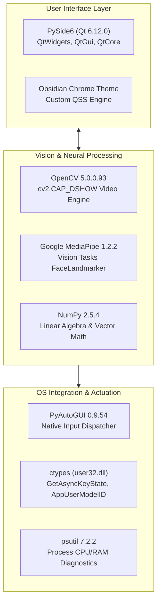

# HeadMouseAI — Technology Stack & Hardware Requirements

> **Document Type:** Technical Stack Specification  
> **Target Project:** HeadMouseAI (Windows Desktop Hands-Free Controller)  
> **Status:** Production / Release Candidate (`v1.0.0-beta.2`)  
> **Audit Date:** November 2026  
> **Verification Status:** Verified via Runtime Environment Inspection & Dependency Audit  

---

## 1. Core Runtime Environment

| Category | Specification / Version | Verification Method |
| :--- | :--- | :--- |
| **Operating System** | Microsoft Windows 10 & 11 (64-bit, x86_64) | Tested on Windows 10/11 build 22631 |
| **Language Runtime** | **Python 3.14.5** (64-bit) | Verified via `python --version` in `.venv` |
| **Compiler & ABI** | MSC v.1944 64 bit (AMD64) | CPython standard Windows build |
| **Execution Architecture**| Native Windows desktop process (`HeadMouseAI.exe`) | PyInstaller one-folder standalone build |

---

## 2. Core Frameworks & Engineering Libraries

### 2.1. GUI Framework — PySide6 (Qt6)
* **Version:** `PySide6 6.12.0` (with `shiboken6 6.12.0`).
* **Components Used:**
  * `PySide6.QtWidgets`: `QMainWindow`, `QTabWidget`, `QVBoxLayout`, `QHBoxLayout`, `QGridLayout`, `QScrollArea`, `QFrame`, `QLabel`, `QPushButton`, `QSlider`, `QCheckBox`, `QStatusBar`, `QMessageBox`.
  * `PySide6.QtGui`: `QImage`, `QPixmap`, `QPainter`, `QColor`, `QFont`, `QIcon`, `QShortcut`, `QKeyEvent`, `QCloseEvent`.
  * `PySide6.QtCore`: `QThread`, `Signal`, `Slot`, `QTimer`, `Qt`, `QPoint`, `QRect`.
* **Tree-Shaking Optimization:** Unused enterprise Qt6 modules (`QtWebEngine`, `QtQuick`, `QtQml`, `QtPdf`, `QtDesigner`, `Qt3D`, `QtSensors`, `QtSerialPort`) are strictly stripped during build time, reducing standalone package size by over 450 MB.

### 2.2. Computer Vision — OpenCV
* **Package:** `opencv-python 5.0.0.93` / `opencv-contrib-python 5.0.0.93`.
* **Backend:** `cv2.CAP_DSHOW` (DirectShow).
* **Role:**
  * Camera device enumeration, hardware property negotiation (brightness, exposure, focus), low-latency frame buffer configuration (`CAP_PROP_BUFFERSIZE = 1`).
  * Color space transformations (`cv2.cvtColor` BGR $\to$ RGB, optimized with zero redundant passes).
  * Video HUD overlay rendering and high-performance NumPy array bridging (`cv2.flip`, `QImage` pointer wrapping).

### 2.3. Neural Inference Engine — Google MediaPipe
* **Package:** `mediapipe 1.2.2`.
* **API:** `mediapipe.tasks.python.vision.FaceLandmarker`.
* **Role:** Low-latency facial landmark extraction predicting 478 3D coordinates per frame using the CPU XNNPACK delegate.

### 2.4. Desktop Automation & OS Actuation — PyAutoGUI & ctypes
* **Package:** `PyAutoGUI 0.9.54`.
* **Sub-dependencies:** `MouseInfo 0.1.3`, `PyGetWindow 0.0.9`, `PyRect 0.2.0`, `PyScreeze 1.0.1`, `pytweening 1.2.0`, `pyperclip 1.11.0`.
* **Role:** Dispatches native mouse moves (`moveTo`), clicks (`click`), hold-to-drag (`mouseDown`/`mouseUp`), document scrolling (`scroll`), and zoom hotkeys (`hotkey('ctrl', '+')`).
* **Win32 API via `ctypes`:**
  * `ctypes.windll.user32.GetAsyncKeyState`: Asynchronous global hardware keyboard polling for `F8` and `F9` hotkeys across all Windows applications.
  * `ctypes.windll.shell32.SetCurrentProcessExplicitAppUserModelID`: Binds the standalone application cleanly to the Windows taskbar with proper window grouping.

### 2.5. Scientific Computing & Diagnostics
* **NumPy (`numpy 2.5.4`):** Array operations, Euclidean distance norms, vector angle math, exponential moving averages, and statistical median baselines.
* **Matplotlib (`matplotlib 3.11.2`):** Embedded real-time telemetry card styling and diagnostic metric computation.
* **psutil (`psutil 7.2.2`):** Live per-process CPU percentage and Resident Set Size (RSS) memory consumption tracking.
* **TOML (`toml 0.10.2`):** Human-readable, structured user preference serialization (`config.toml`).

---

## 3. Complete Python Package Inventory

The following table reflects the exact environment snapshot from `.venv` (Python 3.14.5):

| Package Name | Installed Version | Role in Project |
| :--- | :--- | :--- |
| `mediapipe` | **1.2.2** | Face landmarker vision inference |
| `opencv-python` | **5.0.0.93** | Computer vision & camera capture |
| `opencv-contrib-python` | **5.0.0.93** | Extended OpenCV algorithms and DirectShow support |
| `opencv-python-headless` | **5.0.0.93** | Headless OpenCV support binaries |
| `PySide6` | **6.12.0** | Primary GUI framework |
| `PySide6_Essentials` | **6.12.0** | Core Qt6 libraries |
| `PySide6_Addons` | **6.12.0** | Extended Qt6 widgets and utilities |
| `shiboken6` | **6.12.0** | C++/Python binding generator for PySide6 |
| `numpy` | **2.5.4** | High-performance array and vector math |
| `PyAutoGUI` | **0.9.54** | OS cursor movement and click simulation |
| `matplotlib` | **3.11.2** | Telemetry visualization and data plotting |
| `psutil` | **7.2.2** | System hardware & process resource monitoring |
| `toml` | **0.10.2** | Configuration file serialization/deserialization |
| `pytest` | **9.2.0** | Automated unit and integration test runner |
| `pyinstaller` | **6.22.3** | Standalone EXE packaging engine |
| `pyinstaller-hooks-contrib`| **2026.10** | PyInstaller build hooks for MediaPipe & OpenCV |
| `absl-py` | **2.5.1** | Google Abseil Python utilities (MediaPipe dependency) |
| `flatbuffers` | **25.12.19** | Protocol serialization for MediaPipe models |
| `pillow` | **13.0.0** | Image processing and icon loading |
| `MouseInfo` | **0.1.3** | Mouse coordinate utility for PyAutoGUI |
| `PyGetWindow` | **0.0.9** | Window handle resolution for PyAutoGUI |
| `PyRect` | **0.2.0** | Geometry primitives for PyAutoGUI |
| `PyScreeze` | **1.0.1** | Screen geometry utilities |
| `pyperclip` | **1.11.0** | Clipboard integration for PyAutoGUI |
| `pytweening` | **1.2.0** | Easing functions for PyAutoGUI motion |
| `pywin32-ctypes` | **0.2.3** | Pure-python win32 compatibility |
| `pefile` | **2024.8.26** | PE header inspection tool used by PyInstaller |
| `certifi` | **2026.10.23** | Mozilla CA certificate bundle |
| `cffi` | **2.1.1** | Foreign Function Interface for Python |
| `pycparser` | **3.12** | C parser in Python |
| `colorama` | **0.4.6** | Cross-platform colored terminal output |
| `contourpy` | **1.4.0** | Contour calculation library (Matplotlib dependency) |
| `cycler` | **0.12.1** | Composable style cycles (Matplotlib dependency) |
| `fonttools` | **4.68.0** | Font manipulation library (Matplotlib dependency) |
| `kiwisolver` | **1.5.1** | Cassowary constraint solver (Matplotlib dependency) |
| `python-dateutil` | **4.0.0** | Extensions to standard Python datetime |
| `packaging` | **26.3** | Version parsing and dependency specification |
| `pluggy` | **1.7.0** | Plugin and hook system for pytest |
| `iniconfig` | **2.3.1** | INI parser for pytest |
| `Pygments` | **2.21.0** | Syntax highlighting engine |
| `setuptools` | **84.2.1** | Python package build utilities |
| `tzdata` | **2026.6** | IANA time zone database |

---

## 4. External Build & Packaging Tools

1. **PyInstaller (`6.22.3`):**
   * Configured via `HeadMouseAI.spec`.
   * Produces a standalone, relocatable one-folder Windows application (`dist/HeadMouseAI/`).
   * Strips unnecessary debug symbol tables and unused dynamic link libraries (`.dll`).
2. **Inno Setup (`6.7.3`):**
   * Command-line compiler `ISCC.exe` located at `C:\Users\Admin\AppData\Local\Programs\Inno Setup 6\ISCC.exe`.
   * Compiles the distribution into a single setup installer executable: `HeadMouseAI_Setup.exe` with `lzma2/ultra64` solid compression.

---

## 5. Hardware & Environmental Requirements

### 5.1. System Hardware Requirements

| Component | Minimum Specification | Recommended Specification |
| :--- | :--- | :--- |
| **Processor (CPU)** | Intel Core i3 (6th Gen+) / AMD Ryzen 3 with AVX2 support | Intel Core i5/i7 (8th Gen+) / AMD Ryzen 5+ |
| **Instruction Set** | x86_64 with **AVX / SSE4.2** support (required by MediaPipe XNNPACK) | x86_64 with AVX2 & FMA |
| **System Memory (RAM)** | 4.0 GB | 8.0 GB or greater |
| **Free Storage Space** | 600 MB (Standalone portable or installed) | 1.0 GB (for logs and future updates) |
| **Display Resolution** | $1280 \times 720$ (Minimum UI scale) | $1920 \times 1080$ or higher (Full HD) |

### 5.2. Camera & Video Capture Requirements

| Parameter | Minimum Requirement | Optimal Setting |
| :--- | :--- | :--- |
| **Device Types** | Built-in laptop webcam, USB desktop webcam, smartphone virtual webcam (Iriun Webcam, DroidCam, EpocCam) | Dedicated USB HD Webcam (Logitech C920, Razer Kiyo, etc.) or Iriun 1080p |
| **Driver Interface** | Windows DirectShow (`cv2.CAP_DSHOW`) | DirectShow with 30 FPS fixed capture |
| **Resolution** | $640 \times 480$ pixels | $1280 \times 720$ (720p) |
| **Framerate** | 15–20 frames per second | **30.0 frames per second** (stable) |
| **Camera Placement** | Directly in front of the user at eye level ($\pm 20^\circ$ angular offset) | Eye level, 50–70 cm distance |
| **Environmental Lighting**| Even frontal illumination (>150 lux) | Diffused desk light; avoid harsh backlight or window reflections behind head |
| **Eyeglass Compatibility** | Supported; anti-reflective coating recommended | Compatible; run calibration with eyeglasses on |
